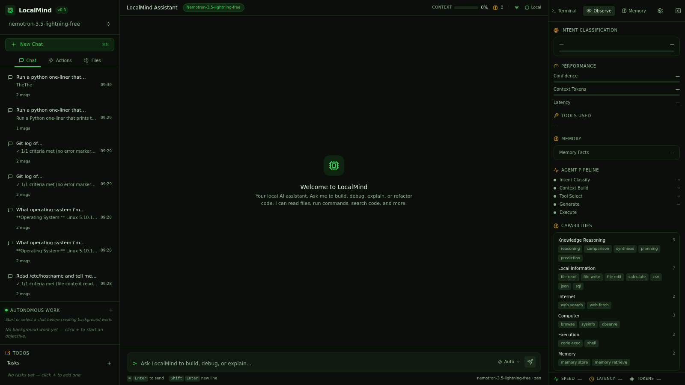
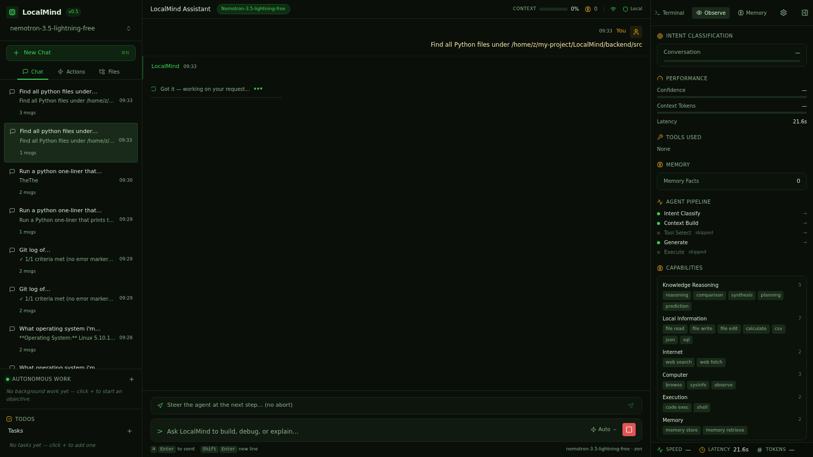

# Smoke Test: find_path

**Prompt:** `Find all Python files under /home/z/my-project/LocalMind/backend/src`
**Category:** find_path
**Captured:** 2026-08-13 09:33:32

---

## SSE Event Stream



### [  4.32s] event #1 — `thinking_start`
```json
{
  "obs_event": {
    "type": "thinking_start",
    "data": {}
  }
}
```

### [  4.32s] event #2 — `thinking_start`
```json
{
  "type": "thinking_start"
}
```

### [  4.32s] event #3 — `thinking_start`
```json
{
  "type": "thinking_start"
}
```

### [ 14.62s] event #4 — `thinking_end`
```json
{
  "type": "thinking_end"
}
```

### [ 14.62s] event #5 — `thinking_start`
```json
{
  "type": "thinking_start"
}
```

### [ 14.63s] event #6 — `thinking_token`
```json
{
  "type": "thinking_token",
  "thinking": "[shell] Find all Python files under the specified directory"
}
```

### [ 14.63s] event #7 — `thinking_end`
```json
{
  "type": "thinking_end"
}
```

### [ 14.63s] event #8 — `thinking_done`
```json
{
  "obs_event": {
    "type": "thinking_done",
    "data": {}
  }
}
```

### [ 14.63s] event #9 — `thinking_end`
```json
{
  "type": "thinking_end"
}
```

### [ 14.63s] event #10 — `intent_classified`
```json
{
  "obs_event": {
    "type": "intent_classified",
    "data": {
      "primary": "shell",
      "confidence": 0.95
    }
  }
}
```

### [ 14.63s] event #11 — `intent`
```json
{
  "type": "intent",
  "intent": "shell",
  "confidence": 0.95
}
```

### [ 14.63s] event #12 — `dispatcher_complete`
```json
{
  "obs_event": {
    "type": "dispatcher_complete",
    "data": {
      "intent": "shell",
      "execution_mode": "single_tool",
      "confidence": 0.95,
      "latency_ms": 10310,
      "capabilities": "['shell']",
      "session_id": "smoke-fi"
    }
  }
}
```

### [ 14.63s] event #13 — `stage_timing`
```json
{
  "obs_event": {
    "type": "stage_timing",
    "data": {
      "stage": "intent_classify",
      "latency_ms": 10310,
      "status": "done"
    }
  }
}
```

### [ 14.63s] event #14 — `stage_timing`
```json
{
  "obs_event": {
    "type": "stage_timing",
    "data": {
      "stage": "tool_select",
      "latency_ms": 0,
      "status": "done"
    }
  }
}
```

### [ 14.63s] event #15 — `memory_retrieved`
```json
{
  "obs_event": {
    "type": "memory_retrieved",
    "data": {
      "facts": 0,
      "latency_ms": 0
    }
  }
}
```

### [ 14.63s] event #16 — `stage_timing`
```json
{
  "obs_event": {
    "type": "stage_timing",
    "data": {
      "stage": "context_build",
      "latency_ms": 0,
      "status": "done"
    }
  }
}
```

### [ 14.63s] event #17 — `status_update`
```json
{
  "type": "status_update",
  "status": "Let me run that command..."
}
```

### [ 14.63s] event #18 — `status_update`
```json
{
  "type": "status_update",
  "status": "Understanding your request..."
}
```

### [ 14.63s] event #19 — `status_update`
```json
{
  "type": "status_update",
  "status": "I'll search for all Python files in that directory using the shell."
}
```

### [ 14.86s] event #20 — `routing_hint_provided`
```json
{
  "obs_event": {
    "type": "routing_hint_provided",
    "data": {
      "intent": "shell",
      "hint_steps": 1,
      "confidence": 0.95
    }
  }
}
```

### [ 14.86s] event #21 — `dispatcher_high_confidence_skip`
```json
{
  "obs_event": {
    "type": "dispatcher_high_confidence_skip",
    "data": {
      "confidence": 0.95,
      "skipped": "['orchestrator']"
    }
  }
}
```

### [ 14.86s] event #22 — `agent_loop_start`
```json
{
  "obs_event": {
    "type": "agent_loop_start",
    "data": {
      "intent": "shell"
    }
  }
}
```

### [ 14.86s] event #23 — `tool_status`
```json
{
  "obs_event": {
    "type": "tool_status",
    "data": {
      "tool": "shell",
      "label": "Running command",
      "status": "running"
    }
  }
}
```

### [ 14.86s] event #24 — `tool_call`
```json
{
  "type": "tool_call",
  "tool_call": {
    "id": "tc-shell-iter",
    "name": "shell",
    "label": "Running command",
    "status": "running",
    "iteration": "",
    "latency_ms": "",
    "output": "",
    "tool_args": "",
    "arguments": "",
    "todo_id": null,
    "thought": null,
    "reasoning": null
  }
}
```

### [ 14.86s] event #25 — `agent_loop_start`
```json
{
  "obs_event": {
    "type": "agent_loop_start",
    "data": {
      "intent": "shell"
    }
  }
}
```

### [ 14.86s] event #26 — `thinking_start`
```json
{
  "type": "thinking_start"
}
```

### [ 17.77s] event #27 — `agent_planning_start`
```json
{
  "obs_event": {
    "type": "agent_planning_start",
    "data": {
      "intent": "shell"
    }
  }
}
```

### [ 17.77s] event #28 — `thinking_token`
```json
{
  "type": "thinking_token",
  "thinking": "UND"
}
```

### [ 17.77s] event #29 — `thinking_token`
```json
{
  "type": "thinking_token",
  "thinking": "ER"
}
```

### [ 17.78s] event #30 — `thinking_token`
```json
{
  "type": "thinking_token",
  "thinking": "ST"
}
```

### [ 17.79s] event #31 — `thinking_token`
```json
{
  "type": "thinking_token",
  "thinking": "AND"
}
```

### [ 17.80s] event #32 — `thinking_token`
```json
{
  "type": "thinking_token",
  "thinking": "ING"
}
```

### [ 17.87s] event #33 — `thinking_token`
```json
{
  "type": "thinking_token",
  "thinking": ":"
}
```

### [ 17.88s] event #34 — `thinking_token`
```json
{
  "type": "thinking_token",
  "thinking": "User"
}
```

### [ 17.90s] event #35 — `thinking_token`
```json
{
  "type": "thinking_token",
  "thinking": "wants"
}
```

### [ 17.90s] event #36 — `thinking_token`
```json
{
  "type": "thinking_token",
  "thinking": "to"
}
```

### [ 17.97s] event #37 — `thinking_token`
```json
{
  "type": "thinking_token",
  "thinking": "find"
}
```

### [ 17.97s] event #38 — `thinking_token`
```json
{
  "type": "thinking_token",
  "thinking": "all"
}
```

### [ 17.98s] event #39 — `thinking_token`
```json
{
  "type": "thinking_token",
  "thinking": "Python"
}
```

### [ 17.99s] event #40 — `thinking_token`
```json
{
  "type": "thinking_token",
  "thinking": "files"
}
```

### [ 18.00s] event #41 — `thinking_token`
```json
{
  "type": "thinking_token",
  "thinking": "in"
}
```

### [ 18.08s] event #42 — `thinking_token`
```json
{
  "type": "thinking_token",
  "thinking": "a"
}
```

### [ 18.09s] event #43 — `thinking_token`
```json
{
  "type": "thinking_token",
  "thinking": "specific"
}
```

### [ 18.10s] event #44 — `thinking_token`
```json
{
  "type": "thinking_token",
  "thinking": "directory"
}
```

### [ 18.11s] event #45 — `thinking_token`
```json
{
  "type": "thinking_token",
  "thinking": "path"
}
```

### [ 18.18s] event #46 — `thinking_token`
```json
{
  "type": "thinking_token",
  "thinking": "."
}
```

### [ 18.18s] event #47 — `thinking_token`
```json
{
  "type": "thinking_token",
  "thinking": "WH"
}
```

### [ 18.18s] event #48 — `thinking_token`
```json
{
  "type": "thinking_token",
  "thinking": "AT"
}
```

### [ 18.19s] event #49 — `thinking_token`
```json
{
  "type": "thinking_token",
  "thinking": "I"
}
```

### [ 18.20s] event #50 — `thinking_token`
```json
{
  "type": "thinking_token",
  "thinking": "K"
}
```

### [ 18.27s] event #51 — `thinking_token`
```json
{
  "type": "thinking_token",
  "thinking": "N"
}
```

### [ 18.28s] event #52 — `thinking_token`
```json
{
  "type": "thinking_token",
  "thinking": "OW"
}
```

### [ 18.29s] event #53 — `thinking_token`
```json
{
  "type": "thinking_token",
  "thinking": ":"
}
```

### [ 18.30s] event #54 — `thinking_token`
```json
{
  "type": "thinking_token",
  "thinking": "The"
}
```

### [ 18.37s] event #55 — `thinking_token`
```json
{
  "type": "thinking_token",
  "thinking": "target"
}
```

### [ 18.38s] event #56 — `thinking_token`
```json
{
  "type": "thinking_token",
  "thinking": "directory"
}
```

### [ 18.38s] event #57 — `thinking_token`
```json
{
  "type": "thinking_token",
  "thinking": "is"
}
```

### [ 18.40s] event #58 — `thinking_token`
```json
{
  "type": "thinking_token",
  "thinking": "/"
}
```

### [ 18.40s] event #59 — `thinking_token`
```json
{
  "type": "thinking_token",
  "thinking": "home"
}
```

### [ 18.48s] event #60 — `thinking_token`
```json
{
  "type": "thinking_token",
  "thinking": "/z"
}
```

### [ 18.48s] event #61 — `thinking_token`
```json
{
  "type": "thinking_token",
  "thinking": "/my"
}
```

### [ 18.49s] event #62 — `thinking_token`
```json
{
  "type": "thinking_token",
  "thinking": "-project"
}
```

### [ 18.50s] event #63 — `thinking_token`
```json
{
  "type": "thinking_token",
  "thinking": "/L"
}
```

### [ 18.57s] event #64 — `thinking_token`
```json
{
  "type": "thinking_token",
  "thinking": "ocal"
}
```

### [ 18.59s] event #65 — `thinking_token`
```json
{
  "type": "thinking_token",
  "thinking": "Mind"
}
```

### [ 18.59s] event #66 — `thinking_token`
```json
{
  "type": "thinking_token",
  "thinking": "/backend"
}
```

### [ 18.60s] event #67 — `thinking_token`
```json
{
  "type": "thinking_token",
  "thinking": "/src"
}
```

### [ 18.67s] event #68 — `thinking_token`
```json
{
  "type": "thinking_token",
  "thinking": ","
}
```

### [ 18.68s] event #69 — `thinking_token`
```json
{
  "type": "thinking_token",
  "thinking": "and"
}
```

### [ 18.68s] event #70 — `thinking_token`
```json
{
  "type": "thinking_token",
  "thinking": "I"
}
```

### [ 18.69s] event #71 — `thinking_token`
```json
{
  "type": "thinking_token",
  "thinking": "'m"
}
```

### [ 18.70s] event #72 — `thinking_token`
```json
{
  "type": "thinking_token",
  "thinking": "looking"
}
```

### [ 18.78s] event #73 — `thinking_token`
```json
{
  "type": "thinking_token",
  "thinking": "for"
}
```

### [ 18.78s] event #74 — `thinking_token`
```json
{
  "type": "thinking_token",
  "thinking": "files"
}
```

### [ 18.79s] event #75 — `thinking_token`
```json
{
  "type": "thinking_token",
  "thinking": "with"
}
```

### [ 18.81s] event #76 — `thinking_token`
```json
{
  "type": "thinking_token",
  "thinking": "."
}
```

### [ 18.88s] event #77 — `thinking_token`
```json
{
  "type": "thinking_token",
  "thinking": "py"
}
```

### [ 18.93s] event #78 — `thinking_token`
```json
{
  "type": "thinking_token",
  "thinking": "extension"
}
```

### [ 18.93s] event #79 — `thinking_token`
```json
{
  "type": "thinking_token",
  "thinking": "."
}
```

### [ 18.93s] event #80 — `thinking_token`
```json
{
  "type": "thinking_token",
  "thinking": "WH"
}
```

### [ 18.97s] event #81 — `thinking_token`
```json
{
  "type": "thinking_token",
  "thinking": "AT"
}
```

### [ 18.98s] event #82 — `thinking_token`
```json
{
  "type": "thinking_token",
  "thinking": "I"
}
```

### [ 18.98s] event #83 — `thinking_token`
```json
{
  "type": "thinking_token",
  "thinking": "'"
}
```

### [ 18.99s] event #84 — `thinking_token`
```json
{
  "type": "thinking_token",
  "thinking": "LL"
}
```

### [ 19.00s] event #85 — `thinking_token`
```json
{
  "type": "thinking_token",
  "thinking": "V"
}
```

### [ 19.09s] event #86 — `thinking_token`
```json
{
  "type": "thinking_token",
  "thinking": "ER"
}
```

### [ 19.09s] event #87 — `thinking_token`
```json
{
  "type": "thinking_token",
  "thinking": "IFY"
}
```

### [ 19.09s] event #88 — `thinking_token`
```json
{
  "type": "thinking_token",
  "thinking": ":"
}
```

### [ 19.10s] event #89 — `thinking_token`
```json
{
  "type": "thinking_token",
  "thinking": "That"
}
```

### [ 19.17s] event #90 — `thinking_token`
```json
{
  "type": "thinking_token",
  "thinking": "the"
}
```

### [ 19.17s] event #91 — `thinking_token`
```json
{
  "type": "thinking_token",
  "thinking": "directory"
}
```

### [ 19.19s] event #92 — `thinking_token`
```json
{
  "type": "thinking_token",
  "thinking": "exists"
}
```

### [ 19.20s] event #93 — `thinking_token`
```json
{
  "type": "thinking_token",
  "thinking": "and"
}
```

### [ 19.48s] event #94 — `thinking_token`
```json
{
  "type": "thinking_token",
  "thinking": "contains"
}
```

### [ 19.50s] event #95 — `thinking_token`
```json
{
  "type": "thinking_token",
  "thinking": "Python"
}
```

### [ 19.51s] event #96 — `thinking_token`
```json
{
  "type": "thinking_token",
  "thinking": "files"
}
```

### [ 19.52s] event #97 — `thinking_token`
```json
{
  "type": "thinking_token",
  "thinking": "."
}
```

### [ 19.58s] event #98 — `thinking_token`
```json
{
  "type": "thinking_token",
  "thinking": "ST"
}
```

### [ 19.58s] event #99 — `thinking_token`
```json
{
  "type": "thinking_token",
  "thinking": "EPS"
}
```

### [ 19.59s] event #100 — `thinking_token`
```json
{
  "type": "thinking_token",
  "thinking": ":"
}
```

### [ 19.68s] event #101 — `thinking_token`
```json
{
  "type": "thinking_token",
  "thinking": "1"
}
```

### [ 19.68s] event #102 — `thinking_token`
```json
{
  "type": "thinking_token",
  "thinking": "."
}
```

### [ 19.68s] event #103 — `thinking_token`
```json
{
  "type": "thinking_token",
  "thinking": "Run"
}
```

### [ 19.69s] event #104 — `thinking_token`
```json
{
  "type": "thinking_token",
  "thinking": "`"
}
```

### [ 19.70s] event #105 — `thinking_token`
```json
{
  "type": "thinking_token",
  "thinking": "find"
}
```

### [ 19.78s] event #106 — `thinking_token`
```json
{
  "type": "thinking_token",
  "thinking": "_path"
}
```

### [ 19.80s] event #107 — `thinking_token`
```json
{
  "type": "thinking_token",
  "thinking": "` with"
}
```

### [ 19.80s] event #108 — `thinking_token`
```json
{
  "type": "thinking_token",
  "thinking": "root"
}
```

### [ 19.87s] event #109 — `thinking_token`
```json
{
  "type": "thinking_token",
  "thinking": "=/"
}
```

### [ 20.02s] event #110 — `thinking_token`
```json
{
  "type": "thinking_token",
  "thinking": "home"
}
```

### [ 20.06s] event #111 — `thinking_token`
```json
{
  "type": "thinking_token",
  "thinking": "/z"
}
```

### [ 20.07s] event #112 — `thinking_token`
```json
{
  "type": "thinking_token",
  "thinking": "/my"
}
```

### [ 20.07s] event #113 — `thinking_token`
```json
{
  "type": "thinking_token",
  "thinking": "-project"
}
```

### [ 20.09s] event #114 — `thinking_token`
```json
{
  "type": "thinking_token",
  "thinking": "/L"
}
```

### [ 20.11s] event #115 — `thinking_token`
```json
{
  "type": "thinking_token",
  "thinking": "ocal"
}
```

### [ 20.11s] event #116 — `thinking_token`
```json
{
  "type": "thinking_token",
  "thinking": "Mind"
}
```

### [ 20.11s] event #117 — `thinking_token`
```json
{
  "type": "thinking_token",
  "thinking": "/backend"
}
```

### [ 20.40s] event #118 — `thinking_token`
```json
{
  "type": "thinking_token",
  "thinking": "/src"
}
```

### [ 20.41s] event #119 — `thinking_token`
```json
{
  "type": "thinking_token",
  "thinking": "and"
}
```

### [ 20.41s] event #120 — `thinking_token`
```json
{
  "type": "thinking_token",
  "thinking": "pattern"
}
```

### [ 20.41s] event #121 — `thinking_token`
```json
{
  "type": "thinking_token",
  "thinking": "='"
}
```

### [ 20.41s] event #122 — `thinking_token`
```json
{
  "type": "thinking_token",
  "thinking": "*."
}
```

### [ 20.41s] event #123 — `thinking_token`
```json
{
  "type": "thinking_token",
  "thinking": "py"
}
```

### [ 20.41s] event #124 — `thinking_token`
```json
{
  "type": "thinking_token",
  "thinking": "'"
}
```

### [ 20.41s] event #125 — `thinking_token`
```json
{
  "type": "thinking_token",
  "thinking": "Let"
}
```

### [ 20.42s] event #126 — `thinking_token`
```json
{
  "type": "thinking_token",
  "thinking": "me"
}
```

### [ 20.42s] event #127 — `thinking_token`
```json
{
  "type": "thinking_token",
  "thinking": "execute"
}
```

### [ 20.42s] event #128 — `thinking_token`
```json
{
  "type": "thinking_token",
  "thinking": "this"
}
```

### [ 20.42s] event #129 — `thinking_token`
```json
{
  "type": "thinking_token",
  "thinking": "."
}
```

### [ 20.43s] event #130 — `thinking_end`
```json
{
  "type": "thinking_end"
}
```

### [ 23.48s] event #131 — `agent_planning_done`
```json
{
  "obs_event": {
    "type": "agent_planning_done",
    "data": {
      "intent": "shell",
      "plan_len": 343,
      "iterations_cost": 1
    }
  }
}
```

### [ 23.48s] event #132 — `tool_call`
```json
{
  "obs_event": {
    "type": "tool_call",
    "data": {
      "tool": "find_path",
      "label": "Running find_path",
      "status": "started",
      "tool_args": "{\"name\": \"*.py\", \"root\": \"/home/z/my-project/LocalMind/backend/src\"}",
      "iteration": 1,
      "thought": "",
      "reasoning": ""
    }
  }
}
```

### [ 23.48s] event #133 — `tool_call`
```json
{
  "type": "tool_call",
  "tool_call": {
    "id": "tc-find_path-iter1-48a3f1",
    "name": "find_path",
    "label": "Running find_path",
    "status": "started",
    "iteration": 1,
    "latency_ms": "",
    "output": "",
    "tool_args": "{\"name\": \"*.py\", \"root\": \"/home/z/my-project/LocalMind/backend/src\"}",
    "arguments": "{\"name\": \"*.py\", \"root\": \"/home/z/my-project/LocalMind/backend/src\"}",
    "todo_id": null,
    "thought": null,
    "reasoning": null
  }
}
```

### [ 23.48s] event #134 — `status_update`
```json
{
  "type": "status_update",
  "status": "Running find_path"
}
```

### [ 23.48s] event #135 — `terminal_output`
```json
{
  "obs_event": {
    "type": "terminal_output",
    "data": {
      "tool": "find_path",
      "command": "{\"name\": \"*.py\", \"root\": \"/home/z/my-project/LocalMind/backend/src\"}",
      "output": "Found 10 match(es) for '*.py' under /home/z/my-project/LocalMind/backend/src:\n  \ud83d\udcc4  /home/z/my-project/LocalMind/backend/src/tools/__init__.py\n  \ud83d\udcc4  /home/z/my-project/LocalMind/backend/src/tools/apply_proposed.py\n  \ud83d\udcc4  /home/z/my-project/LocalMind/backend/src/t
```

### [ 23.48s] event #136 — `terminal_event`
```json
{
  "type": "terminal_event",
  "terminal_event": {
    "tool": "find_path",
    "command": "{\"name\": \"*.py\", \"root\": \"/home/z/my-project/LocalMind/backend/src\"}",
    "output": "Found 10 match(es) for '*.py' under /home/z/my-project/LocalMind/backend/src:\n  \ud83d\udcc4  /home/z/my-project/LocalMind/backend/src/tools/__init__.py\n  \ud83d\udcc4  /home/z/my-project/LocalMind/backend/src/tools/apply_proposed.py\n  \ud83d\udcc4  /home/z/my-project/LocalMind/backend/src/tools/base.py\n  \u
```

### [ 23.48s] event #137 — `status_update`
```json
{
  "type": "status_update",
  "status": "Done \u2014 Running find_path (1ms)"
}
```

### [ 23.48s] event #138 — `tool_call`
```json
{
  "obs_event": {
    "type": "tool_call",
    "data": {
      "tool": "find_path",
      "label": "Running find_path",
      "status": "done",
      "output": "Found 10 match(es) for '*.py' under /home/z/my-project/LocalMind/backend/src:\n  \ud83d\udcc4  /home/z/my-project/LocalMind/backend/src/tools/__init__.py\n  \ud83d\udcc4  /home/z/my-project/LocalMind/backend/src/tools/apply_proposed.py\n  \ud83d\udcc4  /home/z/my-project/LocalMind/backend/src/tools/base.py\n  \ud83d\udcc4  /home/z/my-pr
```

### [ 23.48s] event #139 — `tool_call`
```json
{
  "type": "tool_call",
  "tool_call": {
    "id": "tc-find_path-iter1-48a3f1",
    "name": "find_path",
    "label": "Running find_path",
    "status": "done",
    "iteration": 1,
    "latency_ms": 1,
    "output": "Found 10 match(es) for '*.py' under /home/z/my-project/LocalMind/backend/src:\n  \ud83d\udcc4  /home/z/my-project/LocalMind/backend/src/tools/__init__.py\n  \ud83d\udcc4  /home/z/my-project/LocalMind/backend/src/tools/apply_proposed.py\n  \ud83d\udcc4  /home/z/my-project/LocalMind/
```

### [ 23.48s] event #140 — `agent_loop_gate_passed`
```json
{
  "obs_event": {
    "type": "agent_loop_gate_passed",
    "data": {
      "intent": "shell",
      "iterations": 2,
      "reason": "\u2713 2/2 criteria met (Shell command executes without errors, Output contains list of .py files under /home/z/my-project/LocalMind/backend/src)"
    }
  }
}
```

### [ 23.48s] event #141 — `agent_loop_done`
```json
{
  "obs_event": {
    "type": "agent_loop_done",
    "data": {
      "intent": "shell",
      "iterations": 2
    }
  }
}
```

### [ 23.48s] event #142 — `token`
```json
{
  "type": "token",
  "content": "\u2713 2/2 criteria met (Shell command executes without errors, Output contains list of .py files under /home/z/my-project/LocalMind/backend/src)"
}
```

### [ 23.49s] event #143 — `stage_timing`
```json
{
  "obs_event": {
    "type": "stage_timing",
    "data": {
      "stage": "generate",
      "latency_ms": 8639,
      "status": "done"
    }
  }
}
```

### [ 23.49s] event #144 — `stage_timing`
```json
{
  "obs_event": {
    "type": "stage_timing",
    "data": {
      "stage": "execute",
      "latency_ms": 0,
      "status": "done"
    }
  }
}
```

### [ 23.49s] event #145 — `tool_status`
```json
{
  "obs_event": {
    "type": "tool_status",
    "data": {
      "tool": "shell",
      "label": "Running command",
      "status": "done"
    }
  }
}
```

### [ 23.49s] event #146 — `tool_call`
```json
{
  "type": "tool_call",
  "tool_call": {
    "id": "tc-shell-iter",
    "name": "shell",
    "label": "Running command",
    "status": "done",
    "iteration": "",
    "latency_ms": "",
    "output": "",
    "tool_args": "",
    "arguments": "",
    "todo_id": null,
    "thought": null,
    "reasoning": null
  }
}
```

### [ 23.49s] event #147 — `thinking_done`
```json
{
  "obs_event": {
    "type": "thinking_done",
    "data": {
      "intent": "shell"
    }
  }
}
```

### [ 23.49s] event #148 — `thinking_end`
```json
{
  "type": "thinking_end"
}
```

### [ 23.49s] event #149 — `tool_status`
```json
{
  "obs_event": {
    "type": "tool_status",
    "data": {
      "tool": "shell",
      "label": "Running command",
      "status": "done"
    }
  }
}
```

### [ 23.49s] event #150 — `tool_call`
```json
{
  "type": "tool_call",
  "tool_call": {
    "id": "tc-shell-iter",
    "name": "shell",
    "label": "Running command",
    "status": "done",
    "iteration": "",
    "latency_ms": "",
    "output": "",
    "tool_args": "",
    "arguments": "",
    "todo_id": null,
    "thought": null,
    "reasoning": null
  }
}
```

### [ 23.49s] event #151 — `turn_complete`
```json
{
  "obs_event": {
    "type": "turn_complete",
    "data": {
      "intent": "shell",
      "confidence": 0.95,
      "tokens_approx": 35,
      "prompt_tokens_approx": 3141,
      "total_latency_ms": 19168,
      "memory_facts": 0,
      "agent_mode": true,
      "provider_usage": "{}"
    }
  }
}
```

### [ 23.49s] event #152 — `done`
```json
{
  "type": "done"
}
```



---

## Summary

| Metric | Value |
|---|---|
| Total duration | 25.63s |
| Ack received | never |
| Planning started | skipped |
| First tool | n/a |
| Fast-path triggered | no |
| Routing hint | no |
| Agent planning ran | NO (BAD) |
| Total events | 152 |

## Final Answer

```
✓ 2/2 criteria met (Shell command executes without errors, Output contains list of .py files under /home/z/my-project/LocalMind/backend/src)
```
