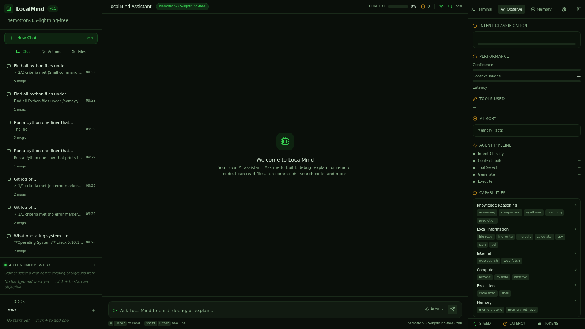
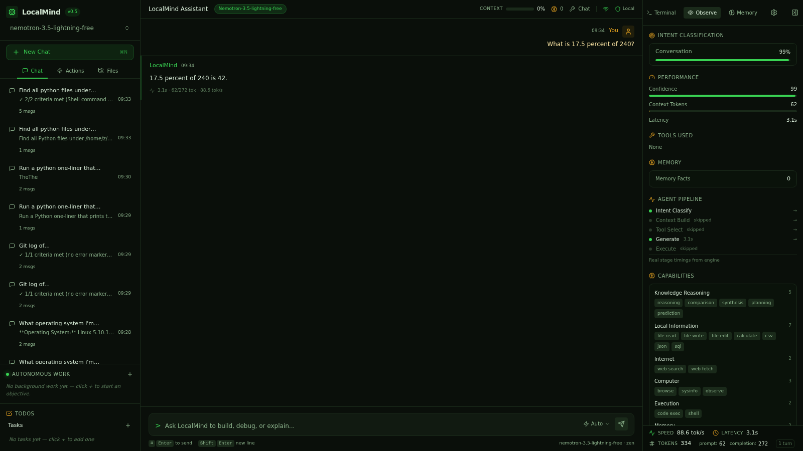

# Smoke Test: calculate

**Prompt:** `What is 17.5 percent of 240?`
**Category:** calculate
**Captured:** 2026-08-13 09:34:30

---

## SSE Event Stream



### [  7.49s] event #1 — `conversational_short_circuit`
```json
{
  "obs_event": {
    "type": "conversational_short_circuit",
    "data": {
      "message_preview": "What is 17.5 percent of 240?",
      "kind": "question"
    }
  }
}
```

### [  7.49s] event #2 — `stage_timing`
```json
{
  "obs_event": {
    "type": "stage_timing",
    "data": {
      "stage": "intent_classify",
      "latency_ms": 0,
      "status": "done"
    }
  }
}
```

### [  7.49s] event #3 — `stage_timing`
```json
{
  "obs_event": {
    "type": "stage_timing",
    "data": {
      "stage": "context_build",
      "latency_ms": 0,
      "status": "skipped"
    }
  }
}
```

### [  7.49s] event #4 — `stage_timing`
```json
{
  "obs_event": {
    "type": "stage_timing",
    "data": {
      "stage": "tool_select",
      "latency_ms": 0,
      "status": "skipped"
    }
  }
}
```

### [  7.49s] event #5 — `token`
```json
{
  "type": "token",
  "content": "4"
}
```

### [  7.50s] event #6 — `token`
```json
{
  "type": "token",
  "content": "2"
}
```

### [  7.50s] event #7 — `done`
```json
{
  "type": "done"
}
```



---

## Summary

| Metric | Value |
|---|---|
| Total duration | 9.64s |
| Ack received | never |
| Planning started | skipped |
| First tool | n/a |
| Fast-path triggered | no |
| Routing hint | no |
| Agent planning ran | NO (BAD) |
| Total events | 7 |

## Final Answer

```
42
```
