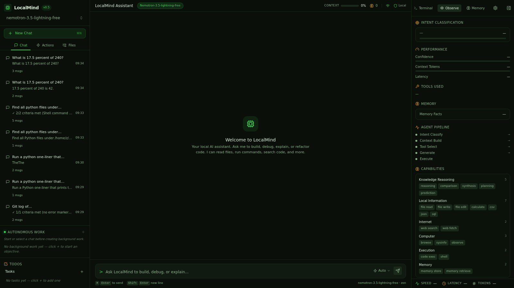
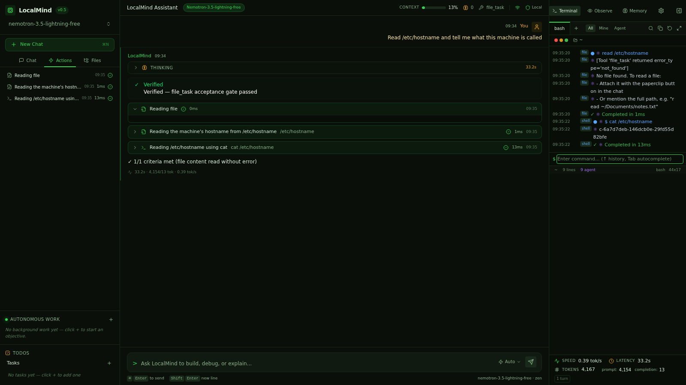

# Smoke Test: file_task

**Prompt:** `Read /etc/hostname and tell me what this machine is called`
**Category:** file_task
**Captured:** 2026-08-13 09:34:45

---

## SSE Event Stream



### [  3.42s] event #1 — `thinking_start`
```json
{
  "obs_event": {
    "type": "thinking_start",
    "data": {}
  }
}
```

### [  3.42s] event #2 — `thinking_start`
```json
{
  "type": "thinking_start"
}
```

### [  3.42s] event #3 — `thinking_start`
```json
{
  "type": "thinking_start"
}
```

### [ 36.14s] event #4 — `thinking_end`
```json
{
  "type": "thinking_end"
}
```

### [ 36.14s] event #5 — `thinking_start`
```json
{
  "type": "thinking_start"
}
```

### [ 36.14s] event #6 — `thinking_token`
```json
{
  "type": "thinking_token",
  "thinking": "[Read File] /etc/hostname"
}
```

### [ 36.14s] event #7 — `thinking_token`
```json
{
  "type": "thinking_token",
  "thinking": "[Tools] File Task"
}
```

### [ 36.14s] event #8 — `thinking_end`
```json
{
  "type": "thinking_end"
}
```

### [ 36.14s] event #9 — `thinking_done`
```json
{
  "obs_event": {
    "type": "thinking_done",
    "data": {}
  }
}
```

### [ 36.14s] event #10 — `thinking_end`
```json
{
  "type": "thinking_end"
}
```

### [ 36.14s] event #11 — `intent_classified`
```json
{
  "obs_event": {
    "type": "intent_classified",
    "data": {
      "primary": "file_task",
      "confidence": 0.95
    }
  }
}
```

### [ 36.14s] event #12 — `intent`
```json
{
  "type": "intent",
  "intent": "file_task",
  "confidence": 0.95
}
```

### [ 36.14s] event #13 — `dispatcher_complete`
```json
{
  "obs_event": {
    "type": "dispatcher_complete",
    "data": {
      "intent": "file_task",
      "execution_mode": "single_tool",
      "confidence": 0.95,
      "latency_ms": 32726,
      "capabilities": "['file_read']",
      "session_id": "smoke-fi"
    }
  }
}
```

### [ 36.14s] event #14 — `stage_timing`
```json
{
  "obs_event": {
    "type": "stage_timing",
    "data": {
      "stage": "intent_classify",
      "latency_ms": 32727,
      "status": "done"
    }
  }
}
```

### [ 36.14s] event #15 — `stage_timing`
```json
{
  "obs_event": {
    "type": "stage_timing",
    "data": {
      "stage": "tool_select",
      "latency_ms": 0,
      "status": "done"
    }
  }
}
```

### [ 36.14s] event #16 — `memory_retrieved`
```json
{
  "obs_event": {
    "type": "memory_retrieved",
    "data": {
      "facts": 0,
      "latency_ms": 0
    }
  }
}
```

### [ 36.14s] event #17 — `stage_timing`
```json
{
  "obs_event": {
    "type": "stage_timing",
    "data": {
      "stage": "context_build",
      "latency_ms": 0,
      "status": "done"
    }
  }
}
```

### [ 36.14s] event #18 — `status_update`
```json
{
  "type": "status_update",
  "status": "Let me read that file..."
}
```

### [ 36.14s] event #19 — `status_update`
```json
{
  "type": "status_update",
  "status": "Understanding your request..."
}
```

### [ 36.14s] event #20 — `status_update`
```json
{
  "type": "status_update",
  "status": "Reading /etc/hostname to determine the machine name."
}
```

### [ 36.17s] event #21 — `dispatcher_high_confidence_skip`
```json
{
  "obs_event": {
    "type": "dispatcher_high_confidence_skip",
    "data": {
      "confidence": 0.95,
      "skipped": "['orchestrator']"
    }
  }
}
```

### [ 36.17s] event #22 — `agent_loop_start`
```json
{
  "obs_event": {
    "type": "agent_loop_start",
    "data": {
      "intent": "file_task"
    }
  }
}
```

### [ 36.17s] event #23 — `tool_status`
```json
{
  "obs_event": {
    "type": "tool_status",
    "data": {
      "tool": "file_task",
      "label": "Reading file",
      "status": "running"
    }
  }
}
```

### [ 36.17s] event #24 — `tool_call`
```json
{
  "type": "tool_call",
  "tool_call": {
    "id": "tc-file_task-iter",
    "name": "file_task",
    "label": "Reading file",
    "status": "running",
    "iteration": "",
    "latency_ms": "",
    "output": "",
    "tool_args": "",
    "arguments": "",
    "todo_id": null,
    "thought": null,
    "reasoning": null
  }
}
```

### [ 36.17s] event #25 — `agent_loop_start`
```json
{
  "obs_event": {
    "type": "agent_loop_start",
    "data": {
      "intent": "file_task"
    }
  }
}
```

### [ 36.17s] event #26 — `thinking_start`
```json
{
  "type": "thinking_start"
}
```

### [ 42.81s] event #27 — `agent_planning_start`
```json
{
  "obs_event": {
    "type": "agent_planning_start",
    "data": {
      "intent": "file_task"
    }
  }
}
```

### [ 42.81s] event #28 — `thinking_token`
```json
{
  "type": "thinking_token",
  "thinking": "I"
}
```

### [ 42.81s] event #29 — `thinking_token`
```json
{
  "type": "thinking_token",
  "thinking": "'ll"
}
```

### [ 42.82s] event #30 — `thinking_token`
```json
{
  "type": "thinking_token",
  "thinking": "read"
}
```

### [ 42.83s] event #31 — `thinking_token`
```json
{
  "type": "thinking_token",
  "thinking": "the"
}
```

### [ 42.83s] event #32 — `thinking_token`
```json
{
  "type": "thinking_token",
  "thinking": "/"
}
```

### [ 42.83s] event #33 — `thinking_token`
```json
{
  "type": "thinking_token",
  "thinking": "etc"
}
```

### [ 42.84s] event #34 — `thinking_token`
```json
{
  "type": "thinking_token",
  "thinking": "/"
}
```

### [ 42.85s] event #35 — `thinking_token`
```json
{
  "type": "thinking_token",
  "thinking": "hostname"
}
```

### [ 42.85s] event #36 — `thinking_token`
```json
{
  "type": "thinking_token",
  "thinking": "file"
}
```

### [ 42.86s] event #37 — `thinking_token`
```json
{
  "type": "thinking_token",
  "thinking": "to"
}
```

### [ 42.86s] event #38 — `thinking_token`
```json
{
  "type": "thinking_token",
  "thinking": "show"
}
```

### [ 42.87s] event #39 — `thinking_token`
```json
{
  "type": "thinking_token",
  "thinking": "its"
}
```

### [ 42.88s] event #40 — `thinking_token`
```json
{
  "type": "thinking_token",
  "thinking": "contents"
}
```

### [ 42.88s] event #41 — `thinking_token`
```json
{
  "type": "thinking_token",
  "thinking": "."
}
```

### [ 42.89s] event #42 — `thinking_token`
```json
{
  "type": "thinking_token",
  "thinking": "1"
}
```

### [ 42.90s] event #43 — `thinking_token`
```json
{
  "type": "thinking_token",
  "thinking": "."
}
```

### [ 42.90s] event #44 — `thinking_token`
```json
{
  "type": "thinking_token",
  "thinking": "Run"
}
```

### [ 42.91s] event #45 — `thinking_token`
```json
{
  "type": "thinking_token",
  "thinking": "`"
}
```

### [ 42.98s] event #46 — `thinking_token`
```json
{
  "type": "thinking_token",
  "thinking": "cat"
}
```

### [ 42.98s] event #47 — `thinking_token`
```json
{
  "type": "thinking_token",
  "thinking": "/"
}
```

### [ 42.99s] event #48 — `thinking_token`
```json
{
  "type": "thinking_token",
  "thinking": "etc"
}
```

### [ 42.99s] event #49 — `thinking_token`
```json
{
  "type": "thinking_token",
  "thinking": "/"
}
```

### [ 42.99s] event #50 — `thinking_token`
```json
{
  "type": "thinking_token",
  "thinking": "hostname"
}
```

### [ 43.00s] event #51 — `thinking_token`
```json
{
  "type": "thinking_token",
  "thinking": "`"
}
```

### [ 43.00s] event #52 — `thinking_token`
```json
{
  "type": "thinking_token",
  "thinking": "to"
}
```

### [ 43.00s] event #53 — `thinking_token`
```json
{
  "type": "thinking_token",
  "thinking": "display"
}
```

### [ 43.00s] event #54 — `thinking_token`
```json
{
  "type": "thinking_token",
  "thinking": "the"
}
```

### [ 43.00s] event #55 — `thinking_token`
```json
{
  "type": "thinking_token",
  "thinking": "hostname"
}
```

### [ 43.00s] event #56 — `thinking_token`
```json
{
  "type": "thinking_token",
  "thinking": "file"
}
```

### [ 43.00s] event #57 — `thinking_token`
```json
{
  "type": "thinking_token",
  "thinking": "contents"
}
```

### [ 43.00s] event #58 — `thinking_token`
```json
{
  "type": "thinking_token",
  "thinking": "."
}
```

### [ 43.01s] event #59 — `thinking_token`
```json
{
  "type": "thinking_token",
  "thinking": "Let"
}
```

### [ 43.01s] event #60 — `thinking_token`
```json
{
  "type": "thinking_token",
  "thinking": "me"
}
```

### [ 43.01s] event #61 — `thinking_token`
```json
{
  "type": "thinking_token",
  "thinking": "execute"
}
```

### [ 43.01s] event #62 — `thinking_token`
```json
{
  "type": "thinking_token",
  "thinking": "this"
}
```

### [ 43.02s] event #63 — `thinking_token`
```json
{
  "type": "thinking_token",
  "thinking": "."
}
```

### [ 43.04s] event #64 — `thinking_end`
```json
{
  "type": "thinking_end"
}
```

### [ 43.04s] event #65 — `agent_planning_done`
```json
{
  "obs_event": {
    "type": "agent_planning_done",
    "data": {
      "intent": "file_task",
      "plan_len": 119,
      "iterations_cost": 1
    }
  }
}
```

### [ 43.04s] event #66 — `agent_loop_gate_passed`
```json
{
  "obs_event": {
    "type": "agent_loop_gate_passed",
    "data": {
      "intent": "file_task",
      "iterations": 1,
      "reason": "direct agent \u2014 single model call, no loop"
    }
  }
}
```

### [ 43.04s] event #67 — `agent_loop_done`
```json
{
  "obs_event": {
    "type": "agent_loop_done",
    "data": {
      "intent": "file_task",
      "iterations": 1
    }
  }
}
```

### [ 43.04s] event #68 — `token`
```json
{
  "type": "token",
  "content": "direct agent \u2014 single model call, no loop"
}
```

### [ 43.04s] event #69 — `stage_timing`
```json
{
  "obs_event": {
    "type": "stage_timing",
    "data": {
      "stage": "generate",
      "latency_ms": 6888,
      "status": "done"
    }
  }
}
```

### [ 43.04s] event #70 — `stage_timing`
```json
{
  "obs_event": {
    "type": "stage_timing",
    "data": {
      "stage": "execute",
      "latency_ms": 0,
      "status": "done"
    }
  }
}
```

### [ 43.04s] event #71 — `tool_status`
```json
{
  "obs_event": {
    "type": "tool_status",
    "data": {
      "tool": "file_task",
      "label": "Reading file",
      "status": "done"
    }
  }
}
```

### [ 43.04s] event #72 — `tool_call`
```json
{
  "type": "tool_call",
  "tool_call": {
    "id": "tc-file_task-iter",
    "name": "file_task",
    "label": "Reading file",
    "status": "done",
    "iteration": "",
    "latency_ms": "",
    "output": "",
    "tool_args": "",
    "arguments": "",
    "todo_id": null,
    "thought": null,
    "reasoning": null
  }
}
```

### [ 43.04s] event #73 — `thinking_done`
```json
{
  "obs_event": {
    "type": "thinking_done",
    "data": {
      "intent": "file_task"
    }
  }
}
```

### [ 43.04s] event #74 — `thinking_end`
```json
{
  "type": "thinking_end"
}
```

### [ 43.04s] event #75 — `tool_status`
```json
{
  "obs_event": {
    "type": "tool_status",
    "data": {
      "tool": "file_task",
      "label": "Reading file",
      "status": "done"
    }
  }
}
```

### [ 43.04s] event #76 — `tool_call`
```json
{
  "type": "tool_call",
  "tool_call": {
    "id": "tc-file_task-iter",
    "name": "file_task",
    "label": "Reading file",
    "status": "done",
    "iteration": "",
    "latency_ms": "",
    "output": "",
    "tool_args": "",
    "arguments": "",
    "todo_id": null,
    "thought": null,
    "reasoning": null
  }
}
```

### [ 43.04s] event #77 — `turn_complete`
```json
{
  "obs_event": {
    "type": "turn_complete",
    "data": {
      "intent": "file_task",
      "confidence": 0.95,
      "tokens_approx": 10,
      "prompt_tokens_approx": 4171,
      "total_latency_ms": 39625,
      "memory_facts": 0,
      "agent_mode": true,
      "provider_usage": "{}"
    }
  }
}
```

### [ 43.04s] event #78 — `anomaly`
```json
{
  "obs_event": {
    "type": "anomaly",
    "data": {
      "kind": "token_leak",
      "severity": "high",
      "title": "Context may have leaked from a previous session",
      "detail": "A new chat reported 4171 context tokens \u2014 within 15% of the previous turn's 4154. A fresh chat should start near zero; history or memory may not have reset.",
      "metrics": "{'context_tokens': 4171, 'prev_context_tokens': 4154}"
    }
  }
}
```

### [ 43.04s] event #79 — `anomaly`
```json
{
  "type": "anomaly",
  "anomaly": {
    "kind": "token_leak",
    "severity": "high",
    "title": "Context may have leaked from a previous session",
    "detail": "A new chat reported 4171 context tokens \u2014 within 15% of the previous turn's 4154. A fresh chat should start near zero; history or memory may not have reset.",
    "metrics": "{'context_tokens': 4171, 'prev_context_tokens': 4154}"
  }
}
```

### [ 43.04s] event #80 — `done`
```json
{
  "type": "done"
}
```



---

## Summary

| Metric | Value |
|---|---|
| Total duration | 45.23s |
| Ack received | never |
| Planning started | skipped |
| First tool | n/a |
| Fast-path triggered | no |
| Routing hint | no |
| Agent planning ran | NO (BAD) |
| Total events | 80 |

## Final Answer

```
direct agent — single model call, no loop
```
