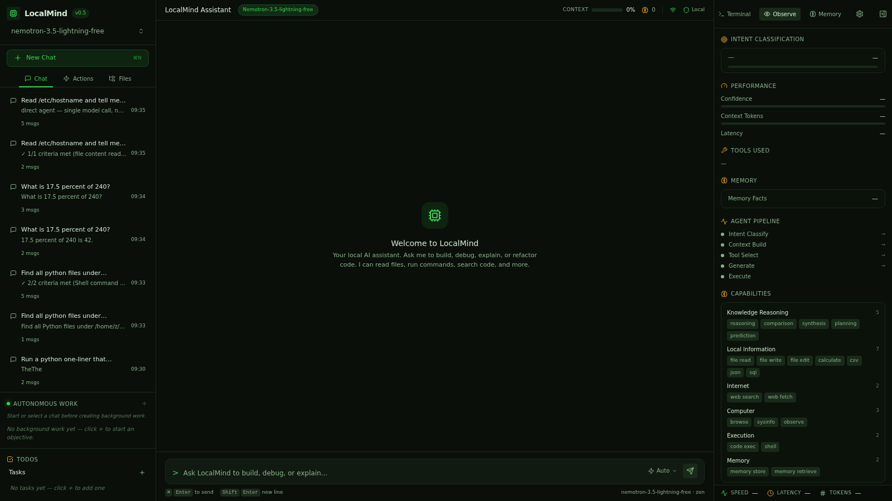
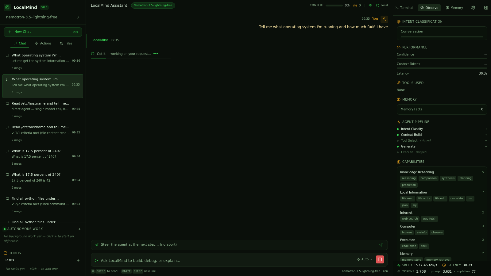

# Smoke Test: sysinfo

**Prompt:** `Tell me what operating system I'm running and how much RAM I have`
**Category:** sysinfo
**Captured:** 2026-08-13 09:35:36

---

## SSE Event Stream



### [  4.06s] event #1 — `thinking_start`
```json
{
  "obs_event": {
    "type": "thinking_start",
    "data": {}
  }
}
```

### [  4.06s] event #2 — `thinking_start`
```json
{
  "type": "thinking_start"
}
```

### [  4.07s] event #3 — `thinking_start`
```json
{
  "type": "thinking_start"
}
```

### [ 29.57s] event #4 — `thinking_end`
```json
{
  "type": "thinking_end"
}
```

### [ 31.84s] event #5 — `stage_timing`
```json
{
  "obs_event": {
    "type": "stage_timing",
    "data": {
      "stage": "intent_classify",
      "latency_ms": 25504,
      "status": "done"
    }
  }
}
```

### [ 31.84s] event #6 — `stage_timing`
```json
{
  "obs_event": {
    "type": "stage_timing",
    "data": {
      "stage": "tool_select",
      "latency_ms": 0,
      "status": "skipped"
    }
  }
}
```

### [ 31.84s] event #7 — `memory_retrieved`
```json
{
  "obs_event": {
    "type": "memory_retrieved",
    "data": {
      "facts": 0,
      "latency_ms": 2
    }
  }
}
```

### [ 31.84s] event #8 — `stage_timing`
```json
{
  "obs_event": {
    "type": "stage_timing",
    "data": {
      "stage": "context_build",
      "latency_ms": 6,
      "status": "done"
    }
  }
}
```

### [ 31.84s] event #9 — `thinking_start`
```json
{
  "obs_event": {
    "type": "thinking_start",
    "data": {
      "intent": "chat"
    }
  }
}
```

### [ 31.84s] event #10 — `thinking_start`
```json
{
  "type": "thinking_start"
}
```

### [ 31.84s] event #11 — `token`
```json
{
  "type": "token",
  "content": "Let"
}
```

### [ 31.84s] event #12 — `token`
```json
{
  "type": "token",
  "content": " me"
}
```

### [ 31.85s] event #13 — `token`
```json
{
  "type": "token",
  "content": " get"
}
```

### [ 31.86s] event #14 — `token`
```json
{
  "type": "token",
  "content": " the"
}
```

### [ 31.86s] event #15 — `token`
```json
{
  "type": "token",
  "content": " system"
}
```

### [ 31.87s] event #16 — `token`
```json
{
  "type": "token",
  "content": " information"
}
```

### [ 31.88s] event #17 — `token`
```json
{
  "type": "token",
  "content": " using"
}
```

### [ 31.88s] event #18 — `token`
```json
{
  "type": "token",
  "content": " the"
}
```

### [ 31.89s] event #19 — `token`
```json
{
  "type": "token",
  "content": " sys"
}
```

### [ 31.89s] event #20 — `token`
```json
{
  "type": "token",
  "content": "info"
}
```

### [ 31.91s] event #21 — `token`
```json
{
  "type": "token",
  "content": " tool"
}
```

### [ 31.91s] event #22 — `token`
```json
{
  "type": "token",
  "content": "."
}
```

### [ 31.93s] event #23 — `thinking_done`
```json
{
  "obs_event": {
    "type": "thinking_done",
    "data": {
      "intent": "chat"
    }
  }
}
```

### [ 31.93s] event #24 — `thinking_end`
```json
{
  "type": "thinking_end"
}
```

### [ 31.93s] event #25 — `stage_timing`
```json
{
  "obs_event": {
    "type": "stage_timing",
    "data": {
      "stage": "generate",
      "latency_ms": 2351,
      "status": "done"
    }
  }
}
```

### [ 31.93s] event #26 — `stage_timing`
```json
{
  "obs_event": {
    "type": "stage_timing",
    "data": {
      "stage": "execute",
      "latency_ms": 0,
      "status": "skipped"
    }
  }
}
```

### [ 31.93s] event #27 — `turn_complete`
```json
{
  "obs_event": {
    "type": "turn_complete",
    "data": {
      "intent": "chat",
      "confidence": 0.3,
      "tokens_approx": 14,
      "prompt_tokens_approx": 3631,
      "total_latency_ms": 27864,
      "memory_facts": 0,
      "agent_mode": false,
      "provider_usage": "{'prompt_tokens': 3631, 'completion_tokens': 77, 'total_tokens': 3708}"
    }
  }
}
```

### [ 31.93s] event #28 — `done`
```json
{
  "type": "done"
}
```



---

## Summary

| Metric | Value |
|---|---|
| Total duration | 34.08s |
| Ack received | never |
| Planning started | skipped |
| First tool | n/a |
| Fast-path triggered | no |
| Routing hint | no |
| Agent planning ran | NO (BAD) |
| Total events | 28 |

## Final Answer

```
Let me get the system information using the sysinfo tool.
```
