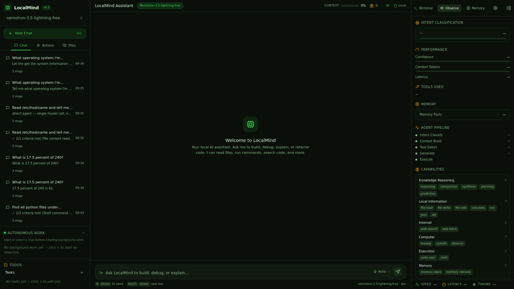
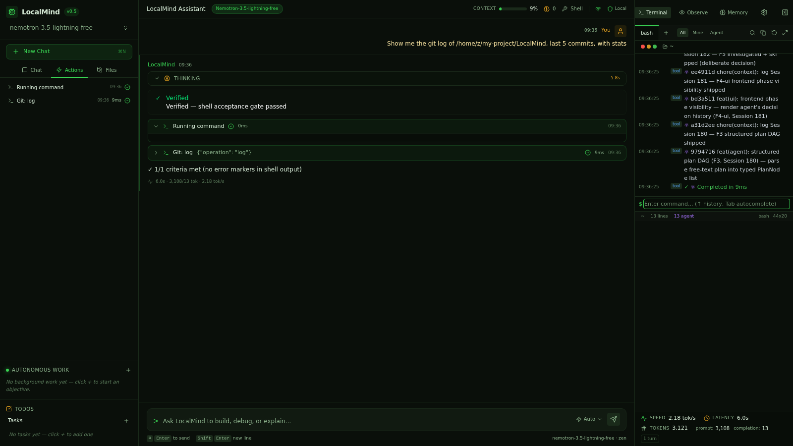

# Smoke Test: shell

**Prompt:** `Show me the git log of /home/z/my-project/LocalMind, last 5 commits, with stats`
**Category:** shell
**Captured:** 2026-08-13 09:36:15

---

## SSE Event Stream



### [  4.35s] event #1 — `dispatcher_signal_detected`
```json
{
  "obs_event": {
    "type": "dispatcher_signal_detected",
    "data": {
      "intent": "shell",
      "execution_mode": "single_tool",
      "message_preview": "Show me the git log of /home/z/my-project/LocalMind, last 5 "
    }
  }
}
```

### [  4.35s] event #2 — `status_update`
```json
{
  "type": "status_update",
  "status": "Checking git log..."
}
```

### [  4.35s] event #3 — `stage_timing`
```json
{
  "obs_event": {
    "type": "stage_timing",
    "data": {
      "stage": "intent_classify",
      "latency_ms": 2,
      "status": "done"
    }
  }
}
```

### [  4.35s] event #4 — `stage_timing`
```json
{
  "obs_event": {
    "type": "stage_timing",
    "data": {
      "stage": "tool_select",
      "latency_ms": 0,
      "status": "done"
    }
  }
}
```

### [  4.35s] event #5 — `memory_retrieved`
```json
{
  "obs_event": {
    "type": "memory_retrieved",
    "data": {
      "facts": 0,
      "latency_ms": 1
    }
  }
}
```

### [  4.35s] event #6 — `stage_timing`
```json
{
  "obs_event": {
    "type": "stage_timing",
    "data": {
      "stage": "context_build",
      "latency_ms": 1,
      "status": "done"
    }
  }
}
```

### [  4.35s] event #7 — `status_update`
```json
{
  "type": "status_update",
  "status": "Let me run that command..."
}
```

### [  4.35s] event #8 — `status_update`
```json
{
  "type": "status_update",
  "status": "Understanding your request..."
}
```

### [  4.35s] event #9 — `status_update`
```json
{
  "type": "status_update",
  "status": "Checking git log..."
}
```

### [  4.37s] event #10 — `routing_hint_provided`
```json
{
  "obs_event": {
    "type": "routing_hint_provided",
    "data": {
      "intent": "shell",
      "hint_steps": 1,
      "confidence": 0.9
    }
  }
}
```

### [  4.37s] event #11 — `dispatcher_high_confidence_skip`
```json
{
  "obs_event": {
    "type": "dispatcher_high_confidence_skip",
    "data": {
      "confidence": 0.9,
      "skipped": "['orchestrator']"
    }
  }
}
```

### [  4.37s] event #12 — `agent_loop_start`
```json
{
  "obs_event": {
    "type": "agent_loop_start",
    "data": {
      "intent": "shell"
    }
  }
}
```

### [  4.37s] event #13 — `tool_status`
```json
{
  "obs_event": {
    "type": "tool_status",
    "data": {
      "tool": "shell",
      "label": "Running command",
      "status": "running"
    }
  }
}
```

### [  4.37s] event #14 — `tool_call`
```json
{
  "type": "tool_call",
  "tool_call": {
    "id": "tc-shell-iter",
    "name": "shell",
    "label": "Running command",
    "status": "running",
    "iteration": "",
    "latency_ms": "",
    "output": "",
    "tool_args": "",
    "arguments": "",
    "todo_id": null,
    "thought": null,
    "reasoning": null
  }
}
```

### [  4.37s] event #15 — `agent_loop_start`
```json
{
  "obs_event": {
    "type": "agent_loop_start",
    "data": {
      "intent": "shell"
    }
  }
}
```

### [  4.37s] event #16 — `thinking_start`
```json
{
  "type": "thinking_start"
}
```

### [  6.50s] event #17 — `agent_planning_start`
```json
{
  "obs_event": {
    "type": "agent_planning_start",
    "data": {
      "intent": "shell"
    }
  }
}
```

### [  6.50s] event #18 — `thinking_token`
```json
{
  "type": "thinking_token",
  "thinking": "UND"
}
```

### [  6.51s] event #19 — `thinking_token`
```json
{
  "type": "thinking_token",
  "thinking": "ER"
}
```

### [  6.51s] event #20 — `thinking_token`
```json
{
  "type": "thinking_token",
  "thinking": "ST"
}
```

### [  6.51s] event #21 — `thinking_token`
```json
{
  "type": "thinking_token",
  "thinking": "AND"
}
```

### [  6.52s] event #22 — `thinking_token`
```json
{
  "type": "thinking_token",
  "thinking": "ING"
}
```

### [  6.52s] event #23 — `thinking_token`
```json
{
  "type": "thinking_token",
  "thinking": ":"
}
```

### [  6.52s] event #24 — `thinking_token`
```json
{
  "type": "thinking_token",
  "thinking": "User"
}
```

### [  6.52s] event #25 — `thinking_token`
```json
{
  "type": "thinking_token",
  "thinking": "wants"
}
```

### [  6.53s] event #26 — `thinking_token`
```json
{
  "type": "thinking_token",
  "thinking": "to"
}
```

### [  6.54s] event #27 — `thinking_token`
```json
{
  "type": "thinking_token",
  "thinking": "see"
}
```

### [  6.54s] event #28 — `thinking_token`
```json
{
  "type": "thinking_token",
  "thinking": "the"
}
```

### [  6.55s] event #29 — `thinking_token`
```json
{
  "type": "thinking_token",
  "thinking": "git"
}
```

### [  6.56s] event #30 — `thinking_token`
```json
{
  "type": "thinking_token",
  "thinking": "commit"
}
```

### [  6.56s] event #31 — `thinking_token`
```json
{
  "type": "thinking_token",
  "thinking": "history"
}
```

### [  6.56s] event #32 — `thinking_token`
```json
{
  "type": "thinking_token",
  "thinking": "/log"
}
```

### [  6.56s] event #33 — `thinking_token`
```json
{
  "type": "thinking_token",
  "thinking": "for"
}
```

### [  6.57s] event #34 — `thinking_token`
```json
{
  "type": "thinking_token",
  "thinking": "the"
}
```

### [  6.57s] event #35 — `thinking_token`
```json
{
  "type": "thinking_token",
  "thinking": "current"
}
```

### [  6.58s] event #36 — `thinking_token`
```json
{
  "type": "thinking_token",
  "thinking": "repository"
}
```

### [  6.58s] event #37 — `thinking_token`
```json
{
  "type": "thinking_token",
  "thinking": "."
}
```

### [  6.58s] event #38 — `thinking_token`
```json
{
  "type": "thinking_token",
  "thinking": "WH"
}
```

### [  6.58s] event #39 — `thinking_token`
```json
{
  "type": "thinking_token",
  "thinking": "AT"
}
```

### [  6.58s] event #40 — `thinking_token`
```json
{
  "type": "thinking_token",
  "thinking": "I"
}
```

### [  6.58s] event #41 — `thinking_token`
```json
{
  "type": "thinking_token",
  "thinking": "K"
}
```

### [  6.58s] event #42 — `thinking_token`
```json
{
  "type": "thinking_token",
  "thinking": "N"
}
```

### [  6.58s] event #43 — `thinking_token`
```json
{
  "type": "thinking_token",
  "thinking": "OW"
}
```

### [  6.58s] event #44 — `thinking_token`
```json
{
  "type": "thinking_token",
  "thinking": ":"
}
```

### [  6.58s] event #45 — `thinking_token`
```json
{
  "type": "thinking_token",
  "thinking": "Current"
}
```

### [  6.59s] event #46 — `thinking_token`
```json
{
  "type": "thinking_token",
  "thinking": "directory"
}
```

### [  6.59s] event #47 — `thinking_token`
```json
{
  "type": "thinking_token",
  "thinking": "is"
}
```

### [  6.59s] event #48 — `thinking_token`
```json
{
  "type": "thinking_token",
  "thinking": "/"
}
```

### [  6.59s] event #49 — `thinking_token`
```json
{
  "type": "thinking_token",
  "thinking": "home"
}
```

### [  6.59s] event #50 — `thinking_token`
```json
{
  "type": "thinking_token",
  "thinking": "/z"
}
```

### [  6.59s] event #51 — `thinking_token`
```json
{
  "type": "thinking_token",
  "thinking": "based"
}
```

### [  6.60s] event #52 — `thinking_token`
```json
{
  "type": "thinking_token",
  "thinking": "on"
}
```

### [  6.60s] event #53 — `thinking_token`
```json
{
  "type": "thinking_token",
  "thinking": "context"
}
```

### [  6.60s] event #54 — `thinking_token`
```json
{
  "type": "thinking_token",
  "thinking": "."
}
```

### [  6.60s] event #55 — `thinking_token`
```json
{
  "type": "thinking_token",
  "thinking": "Today"
}
```

### [  6.60s] event #56 — `thinking_token`
```json
{
  "type": "thinking_token",
  "thinking": "is"
}
```

### [  6.60s] event #57 — `thinking_token`
```json
{
  "type": "thinking_token",
  "thinking": "Thursday"
}
```

### [  6.60s] event #58 — `thinking_token`
```json
{
  "type": "thinking_token",
  "thinking": ", August"
}
```

### [  6.61s] event #59 — `thinking_token`
```json
{
  "type": "thinking_token",
  "thinking": "1"
}
```

### [  6.61s] event #60 — `thinking_token`
```json
{
  "type": "thinking_token",
  "thinking": "3"
}
```

### [  6.61s] event #61 — `thinking_token`
```json
{
  "type": "thinking_token",
  "thinking": ","
}
```

### [  6.61s] event #62 — `thinking_token`
```json
{
  "type": "thinking_token",
  "thinking": "2"
}
```

### [  6.61s] event #63 — `thinking_token`
```json
{
  "type": "thinking_token",
  "thinking": "0"
}
```

### [  6.61s] event #64 — `thinking_token`
```json
{
  "type": "thinking_token",
  "thinking": "2"
}
```

### [  6.61s] event #65 — `thinking_token`
```json
{
  "type": "thinking_token",
  "thinking": "6"
}
```

### [  6.61s] event #66 — `thinking_token`
```json
{
  "type": "thinking_token",
  "thinking": "."
}
```

### [  6.61s] event #67 — `thinking_token`
```json
{
  "type": "thinking_token",
  "thinking": "WH"
}
```

### [  6.61s] event #68 — `thinking_token`
```json
{
  "type": "thinking_token",
  "thinking": "AT"
}
```

### [  6.61s] event #69 — `thinking_token`
```json
{
  "type": "thinking_token",
  "thinking": "I"
}
```

### [  6.61s] event #70 — `thinking_token`
```json
{
  "type": "thinking_token",
  "thinking": "'"
}
```

### [  6.61s] event #71 — `thinking_token`
```json
{
  "type": "thinking_token",
  "thinking": "LL"
}
```

### [  6.61s] event #72 — `thinking_token`
```json
{
  "type": "thinking_token",
  "thinking": "V"
}
```

### [  6.61s] event #73 — `thinking_token`
```json
{
  "type": "thinking_token",
  "thinking": "ER"
}
```

### [  6.61s] event #74 — `thinking_token`
```json
{
  "type": "thinking_token",
  "thinking": "IFY"
}
```

### [  6.62s] event #75 — `thinking_token`
```json
{
  "type": "thinking_token",
  "thinking": ":"
}
```

### [  6.62s] event #76 — `thinking_token`
```json
{
  "type": "thinking_token",
  "thinking": "Whether"
}
```

### [  6.62s] event #77 — `thinking_token`
```json
{
  "type": "thinking_token",
  "thinking": "/"
}
```

### [  6.62s] event #78 — `thinking_token`
```json
{
  "type": "thinking_token",
  "thinking": "home"
}
```

### [  6.62s] event #79 — `thinking_token`
```json
{
  "type": "thinking_token",
  "thinking": "/z"
}
```

### [  6.63s] event #80 — `thinking_token`
```json
{
  "type": "thinking_token",
  "thinking": "is"
}
```

### [  6.64s] event #81 — `thinking_token`
```json
{
  "type": "thinking_token",
  "thinking": "a"
}
```

### [  6.64s] event #82 — `thinking_token`
```json
{
  "type": "thinking_token",
  "thinking": "git"
}
```

### [  6.64s] event #83 — `thinking_token`
```json
{
  "type": "thinking_token",
  "thinking": "repository"
}
```

### [  6.65s] event #84 — `thinking_token`
```json
{
  "type": "thinking_token",
  "thinking": "and"
}
```

### [  6.65s] event #85 — `thinking_token`
```json
{
  "type": "thinking_token",
  "thinking": "what"
}
```

### [  6.65s] event #86 — `thinking_token`
```json
{
  "type": "thinking_token",
  "thinking": "the"
}
```

### [  6.65s] event #87 — `thinking_token`
```json
{
  "type": "thinking_token",
  "thinking": "commit"
}
```

### [  6.66s] event #88 — `thinking_token`
```json
{
  "type": "thinking_token",
  "thinking": "history"
}
```

### [  6.66s] event #89 — `thinking_token`
```json
{
  "type": "thinking_token",
  "thinking": "looks"
}
```

### [  6.66s] event #90 — `thinking_token`
```json
{
  "type": "thinking_token",
  "thinking": "like"
}
```

### [  6.67s] event #91 — `thinking_token`
```json
{
  "type": "thinking_token",
  "thinking": "."
}
```

### [  6.67s] event #92 — `thinking_token`
```json
{
  "type": "thinking_token",
  "thinking": "ST"
}
```

### [  6.68s] event #93 — `thinking_token`
```json
{
  "type": "thinking_token",
  "thinking": "EPS"
}
```

### [  6.68s] event #94 — `thinking_token`
```json
{
  "type": "thinking_token",
  "thinking": ":"
}
```

### [  6.68s] event #95 — `thinking_token`
```json
{
  "type": "thinking_token",
  "thinking": "1"
}
```

### [  6.68s] event #96 — `thinking_token`
```json
{
  "type": "thinking_token",
  "thinking": "."
}
```

### [  6.69s] event #97 — `thinking_token`
```json
{
  "type": "thinking_token",
  "thinking": "Check"
}
```

### [  6.69s] event #98 — `thinking_token`
```json
{
  "type": "thinking_token",
  "thinking": "if"
}
```

### [  6.69s] event #99 — `thinking_token`
```json
{
  "type": "thinking_token",
  "thinking": "current"
}
```

### [  6.69s] event #100 — `thinking_token`
```json
{
  "type": "thinking_token",
  "thinking": "directory"
}
```

### [  6.69s] event #101 — `thinking_token`
```json
{
  "type": "thinking_token",
  "thinking": "is"
}
```

### [  6.69s] event #102 — `thinking_token`
```json
{
  "type": "thinking_token",
  "thinking": "a"
}
```

### [  6.70s] event #103 — `thinking_token`
```json
{
  "type": "thinking_token",
  "thinking": "git"
}
```

### [  6.70s] event #104 — `thinking_token`
```json
{
  "type": "thinking_token",
  "thinking": "repo"
}
```

### [  6.70s] event #105 — `thinking_token`
```json
{
  "type": "thinking_token",
  "thinking": "and"
}
```

### [  6.70s] event #106 — `thinking_token`
```json
{
  "type": "thinking_token",
  "thinking": "run"
}
```

### [  6.70s] event #107 — `thinking_token`
```json
{
  "type": "thinking_token",
  "thinking": "`"
}
```

### [  6.71s] event #108 — `thinking_token`
```json
{
  "type": "thinking_token",
  "thinking": "git"
}
```

### [  6.71s] event #109 — `thinking_token`
```json
{
  "type": "thinking_token",
  "thinking": "log"
}
```

### [  6.71s] event #110 — `thinking_token`
```json
{
  "type": "thinking_token",
  "thinking": "`"
}
```

### [  6.71s] event #111 — `thinking_token`
```json
{
  "type": "thinking_token",
  "thinking": "\u2014"
}
```

### [  6.71s] event #112 — `thinking_token`
```json
{
  "type": "thinking_token",
  "thinking": "use"
}
```

### [  6.72s] event #113 — `thinking_token`
```json
{
  "type": "thinking_token",
  "thinking": "git"
}
```

### [  6.72s] event #114 — `thinking_token`
```json
{
  "type": "thinking_token",
  "thinking": "tool"
}
```

### [  6.72s] event #115 — `thinking_token`
```json
{
  "type": "thinking_token",
  "thinking": "with"
}
```

### [  6.72s] event #116 — `thinking_token`
```json
{
  "type": "thinking_token",
  "thinking": "log"
}
```

### [  6.72s] event #117 — `thinking_token`
```json
{
  "type": "thinking_token",
  "thinking": "operation"
}
```

### [  6.72s] event #118 — `thinking_token`
```json
{
  "type": "thinking_token",
  "thinking": "."
}
```

### [  6.73s] event #119 — `thinking_token`
```json
{
  "type": "thinking_token",
  "thinking": "2"
}
```

### [  6.73s] event #120 — `thinking_token`
```json
{
  "type": "thinking_token",
  "thinking": "."
}
```

### [  6.73s] event #121 — `thinking_token`
```json
{
  "type": "thinking_token",
  "thinking": "Return"
}
```

### [  6.73s] event #122 — `thinking_token`
```json
{
  "type": "thinking_token",
  "thinking": "the"
}
```

### [  6.73s] event #123 — `thinking_token`
```json
{
  "type": "thinking_token",
  "thinking": "commit"
}
```

### [  6.73s] event #124 — `thinking_token`
```json
{
  "type": "thinking_token",
  "thinking": "history"
}
```

### [  6.73s] event #125 — `thinking_token`
```json
{
  "type": "thinking_token",
  "thinking": "to"
}
```

### [  6.73s] event #126 — `thinking_token`
```json
{
  "type": "thinking_token",
  "thinking": "the"
}
```

### [  6.73s] event #127 — `thinking_token`
```json
{
  "type": "thinking_token",
  "thinking": "user"
}
```

### [  6.73s] event #128 — `thinking_token`
```json
{
  "type": "thinking_token",
  "thinking": "."
}
```

### [  6.73s] event #129 — `thinking_token`
```json
{
  "type": "thinking_token",
  "thinking": "Let"
}
```

### [  6.74s] event #130 — `thinking_token`
```json
{
  "type": "thinking_token",
  "thinking": "me"
}
```

### [  6.74s] event #131 — `thinking_token`
```json
{
  "type": "thinking_token",
  "thinking": "execute"
}
```

### [  6.74s] event #132 — `thinking_token`
```json
{
  "type": "thinking_token",
  "thinking": "this"
}
```

### [  6.74s] event #133 — `thinking_token`
```json
{
  "type": "thinking_token",
  "thinking": "."
}
```

### [  6.74s] event #134 — `thinking_end`
```json
{
  "type": "thinking_end"
}
```

### [  9.42s] event #135 — `agent_planning_done`
```json
{
  "obs_event": {
    "type": "agent_planning_done",
    "data": {
      "intent": "shell",
      "plan_len": 368,
      "iterations_cost": 1
    }
  }
}
```

### [  9.42s] event #136 — `tool_call`
```json
{
  "obs_event": {
    "type": "tool_call",
    "data": {
      "tool": "shell",
      "label": "Check if LocalMind directory exists",
      "status": "started",
      "tool_args": "ls -la /home/z/my-project/LocalMind/",
      "iteration": 1,
      "thought": "",
      "reasoning": ""
    }
  }
}
```

### [  9.42s] event #137 — `tool_call`
```json
{
  "type": "tool_call",
  "tool_call": {
    "id": "tc-shell-iter1-7ce5d5",
    "name": "shell",
    "label": "Check if LocalMind directory exists",
    "status": "started",
    "iteration": 1,
    "latency_ms": "",
    "output": "",
    "tool_args": "ls -la /home/z/my-project/LocalMind/",
    "arguments": "ls -la /home/z/my-project/LocalMind/",
    "todo_id": null,
    "thought": null,
    "reasoning": null
  }
}
```

### [  9.42s] event #138 — `status_update`
```json
{
  "type": "status_update",
  "status": "Check if LocalMind directory exists"
}
```

### [  9.43s] event #139 — `terminal_output`
```json
{
  "obs_event": {
    "type": "terminal_output",
    "data": {
      "tool": "shell",
      "command": "ls -la /home/z/my-project/LocalMind/",
      "output": "total 688\ndrwxr-xr-x  11 z z   4096 Aug 13 04:55 .\ndrwxr-xr-x   1 z z   4096 Aug 13 08:18 ..\ndrwxr-xr-x   4 z z   4096 Aug 13 03:50 .context\ndrwxr-xr-x   8 z z   4096 Aug 13 09:36 .git\n-rwxr-xr-x   1 z z    799 Aug 13 03:50 .gitignore\n-rwxr-xr-x   1 z z    743 Aug 13 03:50 .pre-commit-config.yaml\n-rwxr-xr-x   1 z z  11846 Aug 13 0
```

### [  9.43s] event #140 — `terminal_event`
```json
{
  "type": "terminal_event",
  "terminal_event": {
    "tool": "shell",
    "command": "ls -la /home/z/my-project/LocalMind/",
    "output": "total 688\ndrwxr-xr-x  11 z z   4096 Aug 13 04:55 .\ndrwxr-xr-x   1 z z   4096 Aug 13 08:18 ..\ndrwxr-xr-x   4 z z   4096 Aug 13 03:50 .context\ndrwxr-xr-x   8 z z   4096 Aug 13 09:36 .git\n-rwxr-xr-x   1 z z    799 Aug 13 03:50 .gitignore\n-rwxr-xr-x   1 z z    743 Aug 13 03:50 .pre-commit-config.yaml\n-rwxr-xr-x   1 z z  11846 Aug 13 03:50 AGENTS.md\n-r
```

### [  9.43s] event #141 — `status_update`
```json
{
  "type": "status_update",
  "status": "Done \u2014 Check if LocalMind directory exists (4ms)"
}
```

### [  9.43s] event #142 — `tool_call`
```json
{
  "obs_event": {
    "type": "tool_call",
    "data": {
      "tool": "shell",
      "label": "Check if LocalMind directory exists",
      "status": "done",
      "output": "total 688\ndrwxr-xr-x  11 z z   4096 Aug 13 04:55 .\ndrwxr-xr-x   1 z z   4096 Aug 13 08:18 ..\ndrwxr-xr-x   4 z z   4096 Aug 13 03:50 .context\ndrwxr-xr-x   8 z z   4096 Aug 13 09:36 .git\n-rwxr-xr-x   1 z z    799 Aug 13 03:50 .gitignore\n-rwxr-xr-x   1 z z    743 Aug 13 03:50 .pre-commit-config.yaml\n-rwxr-xr-x   1 z z 
```

### [  9.43s] event #143 — `tool_call`
```json
{
  "type": "tool_call",
  "tool_call": {
    "id": "tc-shell-iter1-7ce5d5",
    "name": "shell",
    "label": "Check if LocalMind directory exists",
    "status": "done",
    "iteration": 1,
    "latency_ms": 4,
    "output": "total 688\ndrwxr-xr-x  11 z z   4096 Aug 13 04:55 .\ndrwxr-xr-x   1 z z   4096 Aug 13 08:18 ..\ndrwxr-xr-x   4 z z   4096 Aug 13 03:50 .context\ndrwxr-xr-x   8 z z   4096 Aug 13 09:36 .git\n-rwxr-xr-x   1 z z    799 Aug 13 03:50 .gitignore\n-rwxr-xr-x   1 z z    743 Aug 1
```

### [  9.43s] event #144 — `agent_loop_gate_passed`
```json
{
  "obs_event": {
    "type": "agent_loop_gate_passed",
    "data": {
      "intent": "shell",
      "iterations": 2,
      "reason": "\u2713 1/1 criteria met (no error markers in shell output)"
    }
  }
}
```

### [  9.43s] event #145 — `agent_loop_done`
```json
{
  "obs_event": {
    "type": "agent_loop_done",
    "data": {
      "intent": "shell",
      "iterations": 2
    }
  }
}
```

### [  9.43s] event #146 — `token`
```json
{
  "type": "token",
  "content": "\u2713 1/1 criteria met (no error markers in shell output)"
}
```

### [  9.43s] event #147 — `stage_timing`
```json
{
  "obs_event": {
    "type": "stage_timing",
    "data": {
      "stage": "generate",
      "latency_ms": 5076,
      "status": "done"
    }
  }
}
```

### [  9.43s] event #148 — `stage_timing`
```json
{
  "obs_event": {
    "type": "stage_timing",
    "data": {
      "stage": "execute",
      "latency_ms": 0,
      "status": "done"
    }
  }
}
```

### [  9.43s] event #149 — `tool_status`
```json
{
  "obs_event": {
    "type": "tool_status",
    "data": {
      "tool": "shell",
      "label": "Running command",
      "status": "done"
    }
  }
}
```

### [  9.43s] event #150 — `tool_call`
```json
{
  "type": "tool_call",
  "tool_call": {
    "id": "tc-shell-iter",
    "name": "shell",
    "label": "Running command",
    "status": "done",
    "iteration": "",
    "latency_ms": "",
    "output": "",
    "tool_args": "",
    "arguments": "",
    "todo_id": null,
    "thought": null,
    "reasoning": null
  }
}
```

### [  9.43s] event #151 — `thinking_done`
```json
{
  "obs_event": {
    "type": "thinking_done",
    "data": {
      "intent": "shell"
    }
  }
}
```

### [  9.43s] event #152 — `thinking_end`
```json
{
  "type": "thinking_end"
}
```

### [  9.43s] event #153 — `tool_status`
```json
{
  "obs_event": {
    "type": "tool_status",
    "data": {
      "tool": "shell",
      "label": "Running command",
      "status": "done"
    }
  }
}
```

### [  9.43s] event #154 — `tool_call`
```json
{
  "type": "tool_call",
  "tool_call": {
    "id": "tc-shell-iter",
    "name": "shell",
    "label": "Running command",
    "status": "done",
    "iteration": "",
    "latency_ms": "",
    "output": "",
    "tool_args": "",
    "arguments": "",
    "todo_id": null,
    "thought": null,
    "reasoning": null
  }
}
```

### [  9.43s] event #155 — `turn_complete`
```json
{
  "obs_event": {
    "type": "turn_complete",
    "data": {
      "intent": "shell",
      "confidence": 0.9,
      "tokens_approx": 13,
      "prompt_tokens_approx": 3141,
      "total_latency_ms": 5087,
      "memory_facts": 0,
      "agent_mode": true,
      "provider_usage": "{}"
    }
  }
}
```

### [  9.43s] event #156 — `done`
```json
{
  "type": "done"
}
```



---

## Summary

| Metric | Value |
|---|---|
| Total duration | 11.61s |
| Ack received | never |
| Planning started | skipped |
| First tool | n/a |
| Fast-path triggered | no |
| Routing hint | no |
| Agent planning ran | NO (BAD) |
| Total events | 156 |

## Final Answer

```
✓ 1/1 criteria met (no error markers in shell output)
```
