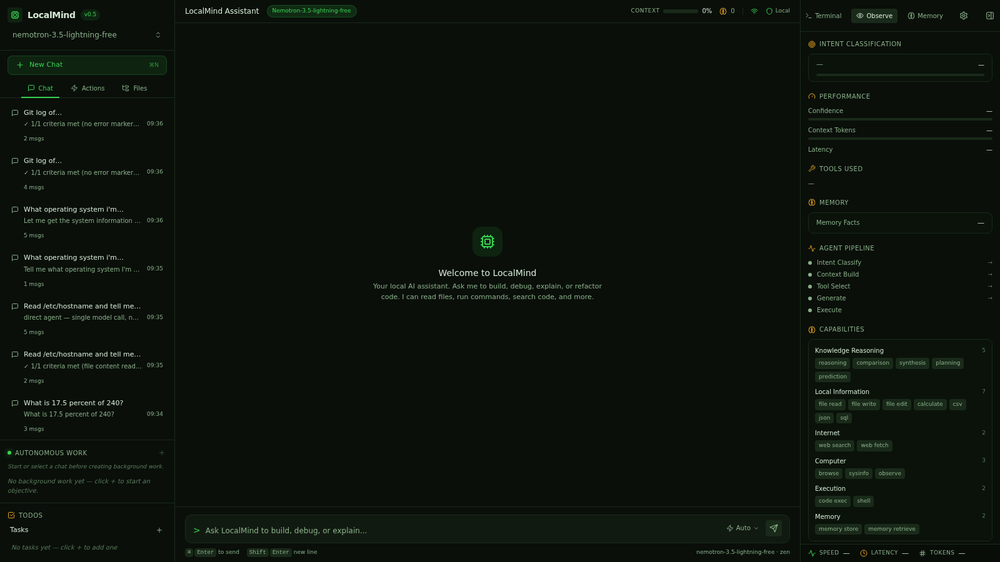
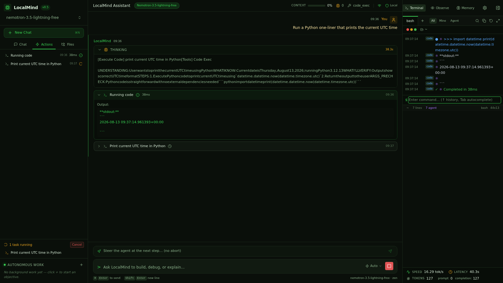

# Smoke Test: code_exec

**Prompt:** `Run a Python one-liner that prints the current UTC time`
**Category:** code_exec
**Captured:** 2026-08-13 09:36:33

---

## SSE Event Stream



### [  3.47s] event #1 — `thinking_start`
```json
{
  "obs_event": {
    "type": "thinking_start",
    "data": {}
  }
}
```

### [  3.47s] event #2 — `thinking_start`
```json
{
  "type": "thinking_start"
}
```

### [  3.47s] event #3 — `thinking_start`
```json
{
  "type": "thinking_start"
}
```

### [ 30.43s] event #4 — `thinking_end`
```json
{
  "type": "thinking_end"
}
```

### [ 30.43s] event #5 — `thinking_start`
```json
{
  "type": "thinking_start"
}
```

### [ 30.43s] event #6 — `thinking_token`
```json
{
  "type": "thinking_token",
  "thinking": "[code_exec] Execute Python one-liner to print UTC time"
}
```

### [ 30.43s] event #7 — `thinking_end`
```json
{
  "type": "thinking_end"
}
```

### [ 30.43s] event #8 — `thinking_done`
```json
{
  "obs_event": {
    "type": "thinking_done",
    "data": {}
  }
}
```

### [ 30.43s] event #9 — `thinking_end`
```json
{
  "type": "thinking_end"
}
```

### [ 30.43s] event #10 — `intent_classified`
```json
{
  "obs_event": {
    "type": "intent_classified",
    "data": {
      "primary": "code_exec",
      "confidence": 0.95
    }
  }
}
```

### [ 30.43s] event #11 — `intent`
```json
{
  "type": "intent",
  "intent": "code_exec",
  "confidence": 0.95
}
```

### [ 30.43s] event #12 — `dispatcher_complete`
```json
{
  "obs_event": {
    "type": "dispatcher_complete",
    "data": {
      "intent": "code_exec",
      "execution_mode": "single_tool",
      "confidence": 0.95,
      "latency_ms": 26962,
      "capabilities": "['code_exec']",
      "session_id": "smoke-co"
    }
  }
}
```

### [ 30.43s] event #13 — `stage_timing`
```json
{
  "obs_event": {
    "type": "stage_timing",
    "data": {
      "stage": "intent_classify",
      "latency_ms": 26963,
      "status": "done"
    }
  }
}
```

### [ 30.43s] event #14 — `stage_timing`
```json
{
  "obs_event": {
    "type": "stage_timing",
    "data": {
      "stage": "tool_select",
      "latency_ms": 0,
      "status": "done"
    }
  }
}
```

### [ 30.43s] event #15 — `memory_retrieved`
```json
{
  "obs_event": {
    "type": "memory_retrieved",
    "data": {
      "facts": 0,
      "latency_ms": 0
    }
  }
}
```

### [ 30.43s] event #16 — `stage_timing`
```json
{
  "obs_event": {
    "type": "stage_timing",
    "data": {
      "stage": "context_build",
      "latency_ms": 0,
      "status": "done"
    }
  }
}
```

### [ 30.43s] event #17 — `status_update`
```json
{
  "type": "status_update",
  "status": "Let me run that code..."
}
```

### [ 30.43s] event #18 — `status_update`
```json
{
  "type": "status_update",
  "status": "Understanding your request..."
}
```

### [ 30.43s] event #19 — `status_update`
```json
{
  "type": "status_update",
  "status": "I'll execute a Python one-liner to print the current UTC time."
}
```

### [ 30.45s] event #20 — `routing_hint_provided`
```json
{
  "obs_event": {
    "type": "routing_hint_provided",
    "data": {
      "intent": "code_exec",
      "hint_steps": 1,
      "confidence": 0.95
    }
  }
}
```

### [ 30.45s] event #21 — `dispatcher_high_confidence_skip`
```json
{
  "obs_event": {
    "type": "dispatcher_high_confidence_skip",
    "data": {
      "confidence": 0.95,
      "skipped": "['orchestrator']"
    }
  }
}
```

### [ 30.45s] event #22 — `agent_loop_start`
```json
{
  "obs_event": {
    "type": "agent_loop_start",
    "data": {
      "intent": "code_exec"
    }
  }
}
```

### [ 30.45s] event #23 — `tool_status`
```json
{
  "obs_event": {
    "type": "tool_status",
    "data": {
      "tool": "code_exec",
      "label": "Running code",
      "status": "running"
    }
  }
}
```

### [ 30.45s] event #24 — `tool_call`
```json
{
  "type": "tool_call",
  "tool_call": {
    "id": "tc-code_exec-iter",
    "name": "code_exec",
    "label": "Running code",
    "status": "running",
    "iteration": "",
    "latency_ms": "",
    "output": "",
    "tool_args": "",
    "arguments": "",
    "todo_id": null,
    "thought": null,
    "reasoning": null
  }
}
```

### [ 30.45s] event #25 — `agent_loop_start`
```json
{
  "obs_event": {
    "type": "agent_loop_start",
    "data": {
      "intent": "code_exec"
    }
  }
}
```

### [ 30.45s] event #26 — `thinking_start`
```json
{
  "type": "thinking_start"
}
```

### [ 33.48s] event #27 — `agent_planning_start`
```json
{
  "obs_event": {
    "type": "agent_planning_start",
    "data": {
      "intent": "code_exec"
    }
  }
}
```

### [ 33.48s] event #28 — `thinking_token`
```json
{
  "type": "thinking_token",
  "thinking": "UND"
}
```

### [ 33.48s] event #29 — `thinking_token`
```json
{
  "type": "thinking_token",
  "thinking": "ER"
}
```

### [ 33.49s] event #30 — `thinking_token`
```json
{
  "type": "thinking_token",
  "thinking": "ST"
}
```

### [ 33.58s] event #31 — `thinking_token`
```json
{
  "type": "thinking_token",
  "thinking": "AND"
}
```

### [ 33.59s] event #32 — `thinking_token`
```json
{
  "type": "thinking_token",
  "thinking": "ING"
}
```

### [ 33.60s] event #33 — `thinking_token`
```json
{
  "type": "thinking_token",
  "thinking": ":"
}
```

### [ 33.60s] event #34 — `thinking_token`
```json
{
  "type": "thinking_token",
  "thinking": "User"
}
```

### [ 33.60s] event #35 — `thinking_token`
```json
{
  "type": "thinking_token",
  "thinking": "wants"
}
```

### [ 33.60s] event #36 — `thinking_token`
```json
{
  "type": "thinking_token",
  "thinking": "to"
}
```

### [ 33.61s] event #37 — `thinking_token`
```json
{
  "type": "thinking_token",
  "thinking": "execute"
}
```

### [ 33.61s] event #38 — `thinking_token`
```json
{
  "type": "thinking_token",
  "thinking": "Python"
}
```

### [ 33.61s] event #39 — `thinking_token`
```json
{
  "type": "thinking_token",
  "thinking": "code"
}
```

### [ 33.61s] event #40 — `thinking_token`
```json
{
  "type": "thinking_token",
  "thinking": "to"
}
```

### [ 33.61s] event #41 — `thinking_token`
```json
{
  "type": "thinking_token",
  "thinking": "get"
}
```

### [ 33.61s] event #42 — `thinking_token`
```json
{
  "type": "thinking_token",
  "thinking": "the"
}
```

### [ 33.61s] event #43 — `thinking_token`
```json
{
  "type": "thinking_token",
  "thinking": "current"
}
```

### [ 33.61s] event #44 — `thinking_token`
```json
{
  "type": "thinking_token",
  "thinking": "UTC"
}
```

### [ 33.61s] event #45 — `thinking_token`
```json
{
  "type": "thinking_token",
  "thinking": "datetime"
}
```

### [ 33.61s] event #46 — `thinking_token`
```json
{
  "type": "thinking_token",
  "thinking": "."
}
```

### [ 33.61s] event #47 — `thinking_token`
```json
{
  "type": "thinking_token",
  "thinking": "WH"
}
```

### [ 33.61s] event #48 — `thinking_token`
```json
{
  "type": "thinking_token",
  "thinking": "AT"
}
```

### [ 33.62s] event #49 — `thinking_token`
```json
{
  "type": "thinking_token",
  "thinking": "I"
}
```

### [ 33.63s] event #50 — `thinking_token`
```json
{
  "type": "thinking_token",
  "thinking": "K"
}
```

### [ 33.63s] event #51 — `thinking_token`
```json
{
  "type": "thinking_token",
  "thinking": "N"
}
```

### [ 33.64s] event #52 — `thinking_token`
```json
{
  "type": "thinking_token",
  "thinking": "OW"
}
```

### [ 33.65s] event #53 — `thinking_token`
```json
{
  "type": "thinking_token",
  "thinking": ":"
}
```

### [ 33.65s] event #54 — `thinking_token`
```json
{
  "type": "thinking_token",
  "thinking": "Current"
}
```

### [ 33.67s] event #55 — `thinking_token`
```json
{
  "type": "thinking_token",
  "thinking": "date"
}
```

### [ 33.67s] event #56 — `thinking_token`
```json
{
  "type": "thinking_token",
  "thinking": "is"
}
```

### [ 33.68s] event #57 — `thinking_token`
```json
{
  "type": "thinking_token",
  "thinking": "Thursday"
}
```

### [ 33.68s] event #58 — `thinking_token`
```json
{
  "type": "thinking_token",
  "thinking": ","
}
```

### [ 33.69s] event #59 — `thinking_token`
```json
{
  "type": "thinking_token",
  "thinking": "August"
}
```

### [ 33.70s] event #60 — `thinking_token`
```json
{
  "type": "thinking_token",
  "thinking": "1"
}
```

### [ 33.71s] event #61 — `thinking_token`
```json
{
  "type": "thinking_token",
  "thinking": "3"
}
```

### [ 33.71s] event #62 — `thinking_token`
```json
{
  "type": "thinking_token",
  "thinking": ","
}
```

### [ 33.73s] event #63 — `thinking_token`
```json
{
  "type": "thinking_token",
  "thinking": "2"
}
```

### [ 33.73s] event #64 — `thinking_token`
```json
{
  "type": "thinking_token",
  "thinking": "0"
}
```

### [ 33.74s] event #65 — `thinking_token`
```json
{
  "type": "thinking_token",
  "thinking": "2"
}
```

### [ 33.75s] event #66 — `thinking_token`
```json
{
  "type": "thinking_token",
  "thinking": "6"
}
```

### [ 33.76s] event #67 — `thinking_token`
```json
{
  "type": "thinking_token",
  "thinking": "."
}
```

### [ 33.76s] event #68 — `thinking_token`
```json
{
  "type": "thinking_token",
  "thinking": "Python"
}
```

### [ 33.77s] event #69 — `thinking_token`
```json
{
  "type": "thinking_token",
  "thinking": "3"
}
```

### [ 33.78s] event #70 — `thinking_token`
```json
{
  "type": "thinking_token",
  "thinking": "."
}
```

### [ 33.79s] event #71 — `thinking_token`
```json
{
  "type": "thinking_token",
  "thinking": "1"
}
```

### [ 33.79s] event #72 — `thinking_token`
```json
{
  "type": "thinking_token",
  "thinking": "2"
}
```

### [ 33.80s] event #73 — `thinking_token`
```json
{
  "type": "thinking_token",
  "thinking": "."
}
```

### [ 33.81s] event #74 — `thinking_token`
```json
{
  "type": "thinking_token",
  "thinking": "1"
}
```

### [ 33.82s] event #75 — `thinking_token`
```json
{
  "type": "thinking_token",
  "thinking": "3"
}
```

### [ 33.82s] event #76 — `thinking_token`
```json
{
  "type": "thinking_token",
  "thinking": "is"
}
```

### [ 33.83s] event #77 — `thinking_token`
```json
{
  "type": "thinking_token",
  "thinking": "available"
}
```

### [ 33.83s] event #78 — `thinking_token`
```json
{
  "type": "thinking_token",
  "thinking": "."
}
```

### [ 33.84s] event #79 — `thinking_token`
```json
{
  "type": "thinking_token",
  "thinking": "WH"
}
```

### [ 33.85s] event #80 — `thinking_token`
```json
{
  "type": "thinking_token",
  "thinking": "AT"
}
```

### [ 33.86s] event #81 — `thinking_token`
```json
{
  "type": "thinking_token",
  "thinking": "I"
}
```

### [ 33.86s] event #82 — `thinking_token`
```json
{
  "type": "thinking_token",
  "thinking": "'"
}
```

### [ 33.89s] event #83 — `thinking_token`
```json
{
  "type": "thinking_token",
  "thinking": "LL"
}
```

### [ 33.89s] event #84 — `thinking_token`
```json
{
  "type": "thinking_token",
  "thinking": "V"
}
```

### [ 33.89s] event #85 — `thinking_token`
```json
{
  "type": "thinking_token",
  "thinking": "ER"
}
```

### [ 33.89s] event #86 — `thinking_token`
```json
{
  "type": "thinking_token",
  "thinking": "IFY"
}
```

### [ 33.90s] event #87 — `thinking_token`
```json
{
  "type": "thinking_token",
  "thinking": ":"
}
```

### [ 33.90s] event #88 — `thinking_token`
```json
{
  "type": "thinking_token",
  "thinking": "Output"
}
```

### [ 33.91s] event #89 — `thinking_token`
```json
{
  "type": "thinking_token",
  "thinking": "shows"
}
```

### [ 33.91s] event #90 — `thinking_token`
```json
{
  "type": "thinking_token",
  "thinking": "UTC"
}
```

### [ 33.93s] event #91 — `thinking_token`
```json
{
  "type": "thinking_token",
  "thinking": "datetime"
}
```

### [ 33.93s] event #92 — `thinking_token`
```json
{
  "type": "thinking_token",
  "thinking": "in"
}
```

### [ 33.94s] event #93 — `thinking_token`
```json
{
  "type": "thinking_token",
  "thinking": "proper"
}
```

### [ 33.95s] event #94 — `thinking_token`
```json
{
  "type": "thinking_token",
  "thinking": "format"
}
```

### [ 33.95s] event #95 — `thinking_token`
```json
{
  "type": "thinking_token",
  "thinking": "."
}
```

### [ 33.96s] event #96 — `thinking_token`
```json
{
  "type": "thinking_token",
  "thinking": "ST"
}
```

### [ 33.96s] event #97 — `thinking_token`
```json
{
  "type": "thinking_token",
  "thinking": "EPS"
}
```

### [ 33.97s] event #98 — `thinking_token`
```json
{
  "type": "thinking_token",
  "thinking": ":"
}
```

### [ 33.98s] event #99 — `thinking_token`
```json
{
  "type": "thinking_token",
  "thinking": "1"
}
```

### [ 33.98s] event #100 — `thinking_token`
```json
{
  "type": "thinking_token",
  "thinking": "."
}
```

### [ 33.99s] event #101 — `thinking_token`
```json
{
  "type": "thinking_token",
  "thinking": "Execute"
}
```

### [ 33.99s] event #102 — `thinking_token`
```json
{
  "type": "thinking_token",
  "thinking": "`"
}
```

### [ 34.00s] event #103 — `thinking_token`
```json
{
  "type": "thinking_token",
  "thinking": "import"
}
```

### [ 34.01s] event #104 — `thinking_token`
```json
{
  "type": "thinking_token",
  "thinking": "datetime"
}
```

### [ 34.01s] event #105 — `thinking_token`
```json
{
  "type": "thinking_token",
  "thinking": ";"
}
```

### [ 34.02s] event #106 — `thinking_token`
```json
{
  "type": "thinking_token",
  "thinking": "print"
}
```

### [ 34.03s] event #107 — `thinking_token`
```json
{
  "type": "thinking_token",
  "thinking": "(d"
}
```

### [ 34.03s] event #108 — `thinking_token`
```json
{
  "type": "thinking_token",
  "thinking": "atetime"
}
```

### [ 34.04s] event #109 — `thinking_token`
```json
{
  "type": "thinking_token",
  "thinking": ".datetime"
}
```

### [ 34.05s] event #110 — `thinking_token`
```json
{
  "type": "thinking_token",
  "thinking": "."
}
```

### [ 34.06s] event #111 — `thinking_token`
```json
{
  "type": "thinking_token",
  "thinking": "utc"
}
```

### [ 34.06s] event #112 — `thinking_token`
```json
{
  "type": "thinking_token",
  "thinking": "now"
}
```

### [ 34.07s] event #113 — `thinking_token`
```json
{
  "type": "thinking_token",
  "thinking": "())"
}
```

### [ 34.07s] event #114 — `thinking_token`
```json
{
  "type": "thinking_token",
  "thinking": "`"
}
```

### [ 34.09s] event #115 — `thinking_token`
```json
{
  "type": "thinking_token",
  "thinking": "via"
}
```

### [ 34.09s] event #116 — `thinking_token`
```json
{
  "type": "thinking_token",
  "thinking": "code"
}
```

### [ 34.09s] event #117 — `thinking_token`
```json
{
  "type": "thinking_token",
  "thinking": "_exec"
}
```

### [ 34.11s] event #118 — `thinking_token`
```json
{
  "type": "thinking_token",
  "thinking": "AR"
}
```

### [ 34.12s] event #119 — `thinking_token`
```json
{
  "type": "thinking_token",
  "thinking": "GS"
}
```

### [ 34.13s] event #120 — `thinking_token`
```json
{
  "type": "thinking_token",
  "thinking": "_PRE"
}
```

### [ 34.13s] event #121 — `thinking_token`
```json
{
  "type": "thinking_token",
  "thinking": "CH"
}
```

### [ 34.13s] event #122 — `thinking_token`
```json
{
  "type": "thinking_token",
  "thinking": "EC"
}
```

### [ 34.14s] event #123 — `thinking_token`
```json
{
  "type": "thinking_token",
  "thinking": "K"
}
```

### [ 34.15s] event #124 — `thinking_token`
```json
{
  "type": "thinking_token",
  "thinking": ":"
}
```

### [ 34.16s] event #125 — `thinking_token`
```json
{
  "type": "thinking_token",
  "thinking": "Python"
}
```

### [ 34.16s] event #126 — `thinking_token`
```json
{
  "type": "thinking_token",
  "thinking": "code"
}
```

### [ 34.17s] event #127 — `thinking_token`
```json
{
  "type": "thinking_token",
  "thinking": "is"
}
```

### [ 34.18s] event #128 — `thinking_token`
```json
{
  "type": "thinking_token",
  "thinking": "complete"
}
```

### [ 34.18s] event #129 — `thinking_token`
```json
{
  "type": "thinking_token",
  "thinking": "and"
}
```

### [ 34.19s] event #130 — `thinking_token`
```json
{
  "type": "thinking_token",
  "thinking": "ready"
}
```

### [ 34.20s] event #131 — `thinking_token`
```json
{
  "type": "thinking_token",
  "thinking": "to"
}
```

### [ 34.20s] event #132 — `thinking_token`
```json
{
  "type": "thinking_token",
  "thinking": "execute"
}
```

### [ 34.21s] event #133 — `thinking_token`
```json
{
  "type": "thinking_token",
  "thinking": "."
}
```

### [ 34.24s] event #134 — `thinking_end`
```json
{
  "type": "thinking_end"
}
```

### [ 41.53s] event #135 — `agent_planning_done`
```json
{
  "obs_event": {
    "type": "agent_planning_done",
    "data": {
      "intent": "code_exec",
      "plan_len": 321,
      "iterations_cost": 1
    }
  }
}
```

### [ 41.53s] event #136 — `tool_call`
```json
{
  "obs_event": {
    "type": "tool_call",
    "data": {
      "tool": "code_exec",
      "label": "Executing: import datetime; print(datetime.datetime...",
      "status": "started",
      "tool_args": "import datetime; print(datetime.datetime.utcnow())",
      "iteration": 1,
      "thought": "",
      "reasoning": ""
    }
  }
}
```

### [ 41.53s] event #137 — `tool_call`
```json
{
  "type": "tool_call",
  "tool_call": {
    "id": "tc-code_exec-iter1-562e50",
    "name": "code_exec",
    "label": "Executing: import datetime; print(datetime.datetime...",
    "status": "started",
    "iteration": 1,
    "latency_ms": "",
    "output": "",
    "tool_args": "import datetime; print(datetime.datetime.utcnow())",
    "arguments": "import datetime; print(datetime.datetime.utcnow())",
    "todo_id": null,
    "thought": null,
    "reasoning": null
  }
}
```

### [ 41.53s] event #138 — `status_update`
```json
{
  "type": "status_update",
  "status": "Executing: import datetime; print(datetime.datetime..."
}
```

### [ 41.57s] event #139 — `terminal_output`
```json
{
  "obs_event": {
    "type": "terminal_output",
    "data": {
      "tool": "code_exec",
      "command": "import datetime; print(datetime.datetime.utcnow())",
      "output": "**stdout:**\n```\n2026-08-13 09:37:15.037796\n\n```\n**stderr:**\n```\n/tmp/localmind_exec_mb_ab2f_.py:1: DeprecationWarning: datetime.datetime.utcnow() is deprecated and scheduled for removal in a future version. Use timezone-aware objects to represent datetimes in UTC: datetime.datetime.now(datetime.UTC).\n  import da
```

### [ 41.57s] event #140 — `terminal_event`
```json
{
  "type": "terminal_event",
  "terminal_event": {
    "tool": "code_exec",
    "command": "import datetime; print(datetime.datetime.utcnow())",
    "output": "**stdout:**\n```\n2026-08-13 09:37:15.037796\n\n```\n**stderr:**\n```\n/tmp/localmind_exec_mb_ab2f_.py:1: DeprecationWarning: datetime.datetime.utcnow() is deprecated and scheduled for removal in a future version. Use timezone-aware objects to represent datetimes in UTC: datetime.datetime.now(datetime.UTC).\n  import datetime; print(date
```

### [ 41.58s] event #141 — `status_update`
```json
{
  "type": "status_update",
  "status": "Done \u2014 Executing: import datetime; print(datetime.datetime... (44ms)"
}
```

### [ 41.58s] event #142 — `tool_call`
```json
{
  "obs_event": {
    "type": "tool_call",
    "data": {
      "tool": "code_exec",
      "label": "Executing: import datetime; print(datetime.datetime...",
      "status": "done",
      "output": "**stdout:**\n```\n2026-08-13 09:37:15.037796\n\n```\n**stderr:**\n```\n/tmp/localmind_exec_mb_ab2f_.py:1: DeprecationWarning: datetime.datetime.utcnow() is deprecated and scheduled for removal in a future version. Use timezone-aware objects to represent datetimes in UTC: datetime.datetime.now(datetim
```

### [ 41.58s] event #143 — `tool_call`
```json
{
  "type": "tool_call",
  "tool_call": {
    "id": "tc-code_exec-iter1-562e50",
    "name": "code_exec",
    "label": "Executing: import datetime; print(datetime.datetime...",
    "status": "done",
    "iteration": 1,
    "latency_ms": 44,
    "output": "**stdout:**\n```\n2026-08-13 09:37:15.037796\n\n```\n**stderr:**\n```\n/tmp/localmind_exec_mb_ab2f_.py:1: DeprecationWarning: datetime.datetime.utcnow() is deprecated and scheduled for removal in a future version. Use timezone-aware objects to 
```

### [ 41.58s] event #144 — `agent_loop_gate_passed`
```json
{
  "obs_event": {
    "type": "agent_loop_gate_passed",
    "data": {
      "intent": "code_exec",
      "iterations": 2,
      "reason": "\u2713 2/2 criteria met (code_exec returns output containing a datetime timestamp, No errors in the execution output)"
    }
  }
}
```

### [ 41.58s] event #145 — `agent_loop_done`
```json
{
  "obs_event": {
    "type": "agent_loop_done",
    "data": {
      "intent": "code_exec",
      "iterations": 2
    }
  }
}
```

### [ 41.58s] event #146 — `token`
```json
{
  "type": "token",
  "content": "\u2713 2/2 criteria met (code_exec returns output containing a datetime timestamp, No errors in the execution output)"
}
```

### [ 41.58s] event #147 — `stage_timing`
```json
{
  "obs_event": {
    "type": "stage_timing",
    "data": {
      "stage": "generate",
      "latency_ms": 11134,
      "status": "done"
    }
  }
}
```

### [ 41.58s] event #148 — `stage_timing`
```json
{
  "obs_event": {
    "type": "stage_timing",
    "data": {
      "stage": "execute",
      "latency_ms": 0,
      "status": "done"
    }
  }
}
```

### [ 41.58s] event #149 — `tool_status`
```json
{
  "obs_event": {
    "type": "tool_status",
    "data": {
      "tool": "code_exec",
      "label": "Running code",
      "status": "done"
    }
  }
}
```

### [ 41.58s] event #150 — `tool_call`
```json
{
  "type": "tool_call",
  "tool_call": {
    "id": "tc-code_exec-iter",
    "name": "code_exec",
    "label": "Running code",
    "status": "done",
    "iteration": "",
    "latency_ms": "",
    "output": "",
    "tool_args": "",
    "arguments": "",
    "todo_id": null,
    "thought": null,
    "reasoning": null
  }
}
```

### [ 41.58s] event #151 — `thinking_done`
```json
{
  "obs_event": {
    "type": "thinking_done",
    "data": {
      "intent": "code_exec"
    }
  }
}
```

### [ 41.58s] event #152 — `thinking_end`
```json
{
  "type": "thinking_end"
}
```

### [ 41.58s] event #153 — `tool_status`
```json
{
  "obs_event": {
    "type": "tool_status",
    "data": {
      "tool": "code_exec",
      "label": "Running code",
      "status": "done"
    }
  }
}
```

### [ 41.58s] event #154 — `tool_call`
```json
{
  "type": "tool_call",
  "tool_call": {
    "id": "tc-code_exec-iter",
    "name": "code_exec",
    "label": "Running code",
    "status": "done",
    "iteration": "",
    "latency_ms": "",
    "output": "",
    "tool_args": "",
    "arguments": "",
    "todo_id": null,
    "thought": null,
    "reasoning": null
  }
}
```

### [ 41.58s] event #155 — `turn_complete`
```json
{
  "obs_event": {
    "type": "turn_complete",
    "data": {
      "intent": "code_exec",
      "confidence": 0.95,
      "tokens_approx": 28,
      "prompt_tokens_approx": 4166,
      "total_latency_ms": 38108,
      "memory_facts": 0,
      "agent_mode": true,
      "provider_usage": "{}"
    }
  }
}
```

### [ 41.58s] event #156 — `done`
```json
{
  "type": "done"
}
```



---

## Summary

| Metric | Value |
|---|---|
| Total duration | 43.73s |
| Ack received | never |
| Planning started | skipped |
| First tool | n/a |
| Fast-path triggered | no |
| Routing hint | no |
| Agent planning ran | NO (BAD) |
| Total events | 156 |

## Final Answer

```
✓ 2/2 criteria met (code_exec returns output containing a datetime timestamp, No errors in the execution output)
```
